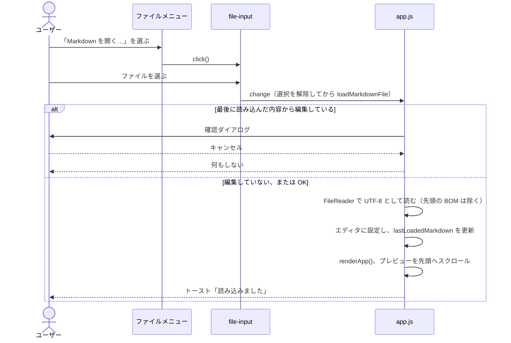

# ファイルの読み込みと初期表示（file-loading）

対応する要求: `FR-006`, `FR-007`（[1.SPEC.md](../../1.SPEC.md)）／アーキテクチャ: [2.ARCHITECTURE.md](../../2.ARCHITECTURE.md) 4.1

## 1. 画面要素

| ID          | 要素                                       | 内容                                                                                                         | 対応する要求 |
| :---------- | :----------------------------------------- | :----------------------------------------------------------------------------------------------------------- | :----------- |
| DD-FILE-001 | ファイルメニューボタン（`#btn-file-menu`） | ヘッダーのロゴの右に置く。押すとメニューを開閉する。開閉の状態を `aria-expanded` に反映する                  | `FR-006`     |
| DD-FILE-002 | ファイルメニュー（`#file-menu`）           | 項目は「Markdown を開く…」（`#menu-open-markdown`）の 1 つ。メニューの外側をクリックするか、Esc キーで閉じる | `FR-006`     |
| DD-FILE-003 | ファイル選択（`#file-input`）              | 非表示の `<input type="file">`。受け付ける拡張子は `.md` / `.markdown` / `.txt`                              | `FR-006`     |
| DD-FILE-004 | 初期案内（`EMPTY_GUIDE_HTML`）             | エディタが空（空白だけの場合を含む）のとき、プレビューに表示する。通常モードではプレビューの本文に、Visual Stage では 1 枚のスラブに入れて表示する | `FR-007` |

## 2. 処理

### DD-FILE-010 ファイルの読み込み

- **編集中の判定**: エディタの内容が `lastLoadedMarkdown`（最後に読み込んだ内容。起動直後は空文字列）と異なれば、編集中とみなす。起動直後の空の状態から入力した場合も編集中になる（`FR-006`）。
- **確認のタイミング**: ファイルを選んだ後に確認する。ファイル選択をキャンセルしたときに確認ダイアログを出さないため。
- **同じファイルの再選択**: `change` の処理の最初に `input.value` を空にする。空にしないと、同じファイルを続けて選んだときに `change` が発生しない。
- **文字コード**: UTF-8 として読む。UTF-8 以外のファイルは文字化けするが、今回の増分では対応しない（未対応と明記する）。
- **読み込みの失敗**: `FileReader` の `error` で、エラーをコンソールに出力し、トーストで知らせる。エディタの内容は変えない。

### DD-FILE-020 起動時の初期表示

- 起動時にエディタへ何も設定せず、`renderApp()` を呼ぶ。エディタが空のため、DD-FILE-004 の案内が表示される。
- サンプル文書は `app.js` に埋め込まない（`FR-007`）。サンプルは同梱の [sample.md](../../../sample.md) を、利用者が DD-FILE-010 で開く。
