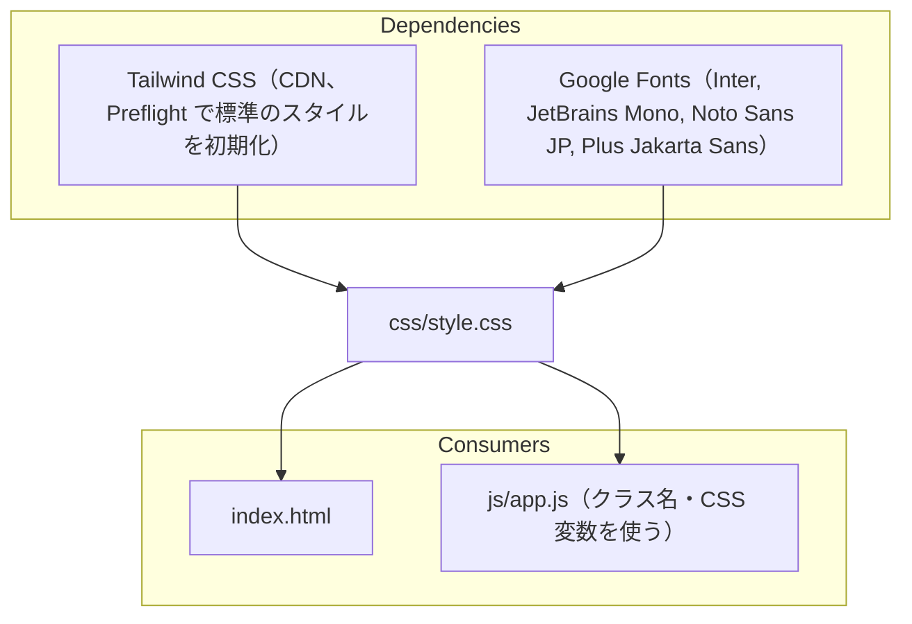

# css/style.css

ソース: [css/style.css](../../../css/style.css)

## 1. 依存関係

- `index.html` で Tailwind の後に読み込むため、同じ詳細度なら本ファイルの定義が優先される。
- KaTeX の CSS（`katex.min.css`）は `index.html` で別に読み込む。

## 2. 構成

| 節                          | 主なセレクタ                                                                         | 役割                             | 対応する設計 ID              |
| :-------------------------- | :----------------------------------------------------------------------------------- | :------------------------------- | :--------------------------- |
| 1. デザイントークン         | `:root`, `body[data-appearance="light" / "dark"]`                                    | Light / Dark の CSS 変数（`--text-*`, `--border-*`, `--accent` など）。`--accent` などは `app.js` がパレットに合わせて上書きする | `FR-004` |
|                             | `.file-menu`, `.file-menu-item`                                                      | ファイルメニュー                 | `DD-FILE-001`, `DD-FILE-002` |
|                             | `.empty-guide`                                                                       | 起動直後の案内                   | `DD-FILE-004`                |
| 2. Mermaid の計測と余白     | `svg .edgeLabel:empty` など                                                          | 空のエッジラベルの余白をなくす   | `DD-DIAG-023`                |
| 3. 通常モードの組版         | `.prose-doc`, `.prose-doc h1`, `.prose-doc h2`, 表（`.table-container`, `th`, `td`） | 仕様書スタイルの本文             | `FR-002`                     |
| 3. Markdown 要素            | `:is(.prose-doc, .exhibition-slab) …`                                                | 見出し・リスト・リンク・コード・引用・表の寄せ・水平線・標準の HTML 要素。通常モードと Visual Stage で共有 | `DD-MD-001`〜`019` |
| 3. 数式                     | `.linea-math[data-display="true"]`                                                   | ブロック数式の配置と横スクロール | `DD-MATH-023`                |
| 3. 図のカード（通常モード） | `.diagram-frame`, `.diagram-viewport`, `.is-actual-size`                             | 図のカードと表示枠、Fit / 1:1    | `DD-DIAG-030`, `DD-DIAG-032` |
| 4. Visual Stage             | `#visual-stage-container`, `.exhibition-*`, `.infographic-bg-<スタイル>`             | 展示レイアウト（ヒーロー、スラブ、図のカード）と、スタイルごとのカード背景 | `FR-003`, `DD-DIAG-021` |
| その他                      | `.callout-box`, `.badge-tag`, `#markdown-editor`, スクロールバー                     | アプリ独自の装飾、エディタ       | -                            |

## 3. 変更するときの注意

- 本文の要素のスタイルは、通常モードと Visual Stage の両方に効くよう `:is(.prose-doc, .exhibition-slab)` で書く（`DD-MD-001`）。
- 背景と見分ける必要がある線は `--border-strong` を使う。Dark の Visual Stage では `--border-subtle` がスラブの背景と同じ色になる（`DD-MD-003`）。
- 図の表示枠（`.diagram-viewport`, `.exhibition-viewport`）は `justify-content: flex-start` とし、中身は左右の `margin: auto` で中央に置く。`center` に戻すと、表示枠より広い図の左側がスクロールで見えなくなる（`DD-DIAG-032`）。
- `* { margin: 0; padding: 0; }` で全要素の余白を消しているため、新しい要素には余白を明示する。
