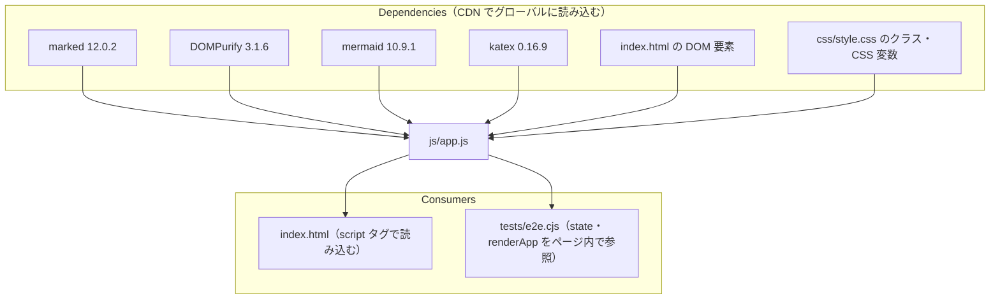
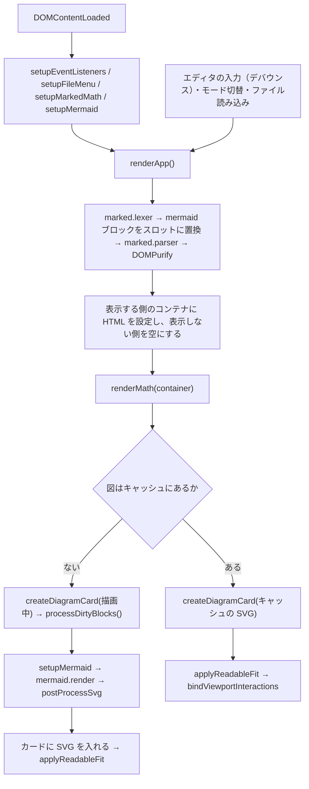

# js/app.js

ソース: [js/app.js](../../../js/app.js)

アプリケーションのすべての処理を持つ、モジュールに分けていない単一のスクリプトである（ビルドなしで `file://` から動かすため、`NFR-001`）。関数と状態はグローバルに置き、`index.html` の最後で読み込む。

## 1. 依存関係

- `tests/e2e.cjs` は、ページ内の `state`、`renderApp()`、`#telemetry-status` の表示（`Rendering` を含むかどうか）を前提にしている。これらの名前や表示を変えるときは、テストも直す。

## 2. 処理の流れ

## 3. 構成（節ごとの関数・定数）

| 節               | 関数・定数                                                                  | 役割                                                                          | 対応する設計 ID              |
| :--------------- | :-------------------------------------------------------------------------- | :---------------------------------------------------------------------------- | :--------------------------- |
| コアエンジン     | `fnv1aHash`, `showToast`, `updateStatus`, `downloadBlob`                    | キャッシュキーのハッシュ、トースト、右下の状態表示、ファイルのダウンロード    | `NFR-002`                    |
| 定数             | `THEMES`（light / dark × 4 パレット）                                       | 通常モードの配色                                                              | `FR-004`                     |
|                  | `VISUAL_THEMES`（shapes / cards / circles / editorial）                     | Visual Stage のスタイルごとの配色                                             | `DD-DIAG-021`                |
|                  | `NODE_DECORATED_TYPES`                                                      | ノード装飾を適用する図種                                                      | `DD-DIAG-011`                |
|                  | `MIN_FIT_FONT_PX`, `SEQUENCE_MATH_LIFT`                                     | Fit の縮小の下限の文字サイズ、シーケンス図の数式のずらし量                    | `DD-DIAG-030`, `DD-DIAG-031` |
|                  | `EMPTY_GUIDE_HTML`                                                          | 起動直後の案内                                                                | `DD-FILE-020`                |
| 状態             | `state`, `svgCache`, `lkgCache`, `renderGeneration`, `lastLoadedMarkdown`   | 表示設定、描画結果のキャッシュ、直前の正常描画、描画世代、最後に読み込んだ内容 | `DD-DIAG-002`, `DD-DIAG-004`, `DD-FILE-010` |
| Mermaid の設定   | `getThemeSpec`, `syncCssTokens`, `getMermaidCurve`, `getDiagramSpec`, `setupMermaid` | 現在のモードの配色を Mermaid の配色変数・CSS 変数に渡す              | `DD-DIAG-021`, `DD-DIAG-022` |
| 数式             | `escapeHtml`, `mathPlaceholder`, `mathBlockExtension`, `mathInlineExtension`, `setupMarkedMath`, `renderMath` | 本文の数式の検出（Marked の拡張）と、サニタイズ後の KaTeX での描画 | `DD-MATH-001`〜`023` |
| SVG の後処理     | `scopeSvgIds`                                                               | SVG 内の id を図ごとに一意にし、参照を書き換える                              | `DD-DIAG-010`                |
|                  | `styleSequenceDiagram`                                                      | シーケンス図のライフライン・活性区間・矢じり・数式の配色と位置                | `DD-DIAG-020`, `DD-DIAG-031` |
|                  | `applyReadableFit`                                                          | Fit の縮小の下限（`min-width`）。DOM に入れた後に呼ぶ                         | `DD-DIAG-030`                |
|                  | `postProcessSvg`, `decorateStandardSvg`, `decorateVisualSvg`                | 図種の判定と、モードごとの装飾の振り分け                                      | `DD-DIAG-011`, `DD-DIAG-012` |
|                  | `addVisualDefs`, `decorateVisualShapes`, `decorateVisualCards`, `decorateVisualCircles`, `decorateVisualEditorial`, `decorateVisualSequence`, `fixMarkerScale` | Visual Stage の 4 スタイルの装飾、シーケンス図の装飾、マーカーの大きさ | `DD-DIAG-013`, `DD-DIAG-021` |
| カードと展示レイアウト | `createDiagramCard`, `buildVisualStageHtml`                           | 図のカードの HTML、Visual Stage のスラブ（`h2` ごと）の HTML                  | `FR-003`, `FR-005`           |
| 描画             | `renderApp`, `processDirtyBlocks`                                           | 描画パイプライン全体と、未キャッシュの図の非同期描画                          | `DD-DIAG-001`〜`004`         |
| ビューポート操作 | `bindViewportInteractions`                                                  | カードの Fit / 1:1 / PNG / SVG / Expand。表示中のコンテナの中だけを対象にする | `DD-DIAG-003`, `DD-DIAG-005` |
| イベント結線     | `setupEventListeners`                                                       | 表示モード・外観・パレット・矢印形状・スタイルの切替、エディタの入力、HTML エクスポート | `FR-001`, `FR-004`, `FR-005` |
| ファイルメニュー | `closeFileMenu`, `confirmDiscardEdits`, `loadMarkdownFile`, `setupFileMenu` | Markdown ファイルの読み込み                                                   | `DD-FILE-001`〜`010`         |
| 起動             | `DOMContentLoaded` のハンドラ                                               | 初期化して、空の状態で 1 回描画する                                           | `DD-FILE-020`                |

## 4. 変更するときの注意

- 要素の検索は、表示中のコンテナ（`#standard-doc-container` または `#visual-stage-container`）の中に限る。`document` 全体から探すと、同じ `data-stage-index` を持つ別のモードの要素を拾う（`DD-DIAG-003`）。
- `postProcessSvg` は、DOM に入れる前の SVG（文書に入れていない `div` の `innerHTML` で読んだもの）を処理する。計算後のスタイルや大きさが必要な処理は、`applyReadableFit` のように DOM に入れた後で行う。
- 描画結果はキャッシュ（`svgCache`）に文字列で保存される。DOM に入れた後の処理（`applyReadableFit`）は、キャッシュから表示するたびに実行される。
- 1 関数 80 行程度の目安（swe3-2）を超えている関数: `setupMermaid`（設定値の並び）、`setupEventListeners`（初期版から）、`bindViewportInteractions`、`renderApp`。分割する場合は、上記の節の単位を保つ。
