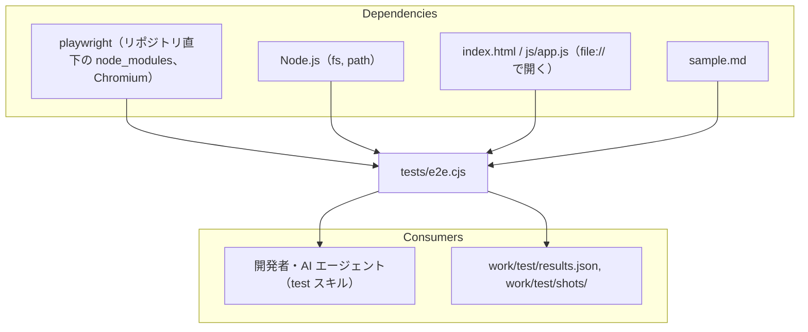

# tests/e2e.cjs

ソース: [tests/e2e.cjs](../../../tests/e2e.cjs)

テスト仕様（[doc/5.test_spec/](../../5.test_spec/README.md)）の「確認方法」が自動の TC を実行し、目視確認用の画像を撮影する。リポジトリの `package.json` が `"type": "module"` のため、CommonJS の拡張子 `.cjs` にしている。

## 1. 依存関係

## 2. 構成

| 関数                               | 役割                                                 | 対応する TC          |
| :--------------------------------- | :--------------------------------------------------- | :------------------- |
| `record`                           | TC の合否を記録し、標準出力に `PASS` / `FAIL` を出す | -                    |
| `openApp`, `waitRendered`, `loadSample`, `setMode` | アプリを開く、図の描画の完了（状態表示に `Rendering` がない）を待つ、`sample.md` を読み込む、表示モードを切り替える | - |
| `testFileLoading`                  | ファイルの読み込みと初期表示                         | `TC-FILE-001`〜`008` |
| `testDiagramRendering`             | 7 モード（`MODES`）で、id の一意性、全図の描画、シーケンス図、マーカー、空のラベル、Fit の文字サイズ、横スクロール、大きな図、図の中の数式を調べ、全図を撮影する。続けて拡大表示、Cards の記号、構文エラー時の表示を調べる | `TC-DIAG-001`〜`014`（`005` の画像）、`TC-MATH-007`, `008` |
| `inspectMarkdown`, `testMarkdownTypography` | 4 モード（`MD_MODES`）で Markdown 要素の計算後のスタイルを調べ、1〜8 章を撮影する | `TC-MD-001`〜`009`（`010` の画像）、`TC-MATH-005` の画像 |
| `inspectMath`, `testMathRendering` | 本文の数式、数式にならない `$`、HTML エクスポート、誤りのある数式、安全性、KaTeX を遮断した場合 | `TC-MATH-001`〜`004`, `006`, `009` |

- `inspectMarkdown` と `inspectMath` は、ページ内で実行する関数（`page.evaluate` に渡す）。Node.js の変数は参照できない。
- 画像のファイル名は `<スタイル>-<外観>-<図の番号 2 桁>.png`（図）と `md-<スタイル>-<外観>.png`（本文）。

## 3. 変更するときの注意

- `sample.md` の構成に依存する箇所がある: 1 つ目の図がフローチャート（`TC-DIAG-007`〜`009`）、8 章の数式の個数（`TC-MATH-001`）、25 章の図の中の数式の個数（`TC-MATH-007`）、23・24 章の大きな図のノード数（`TC-DIAG-014`）。
- 実行すると `work/test/` を上書きする。前回の出力を残す場合は、実行前に別のフォルダへ移す（test スキル）。
- CDN からライブラリを読み込むため、インターネット接続が必要。
