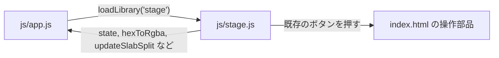

# js/stage.js

ソース: [js/stage.js](../../../js/stage.js)／設計: [stage-show.md](../../3.sw_design_notes/features/stage-show.md)（LIGHT, SHOW）

## 変更するときの注意

- **`app.js` のグローバルへの依存**: `state`、`hexToRgba`、`updateSlabSplit`、`updateAllSlabSplits`、`clearVisualStageSpotlight`、`showToast` を直接使う。`app.js` の後に読み込まれる前提のため、読み込みは必ず `loadLibrary('stage')` を通す。
- **モードの切り替えはボタン経由**: 外観とビューモードは `app.js` の中で複数の表示を更新するため、`stage.js` では状態を直接書き換えず、既存のボタンの `click()` で切り替える。
- **座標系**: 線の座標と光の大きさは図の座標系（viewBox）。画面の大きさへの変換は `flow.matrix` に任せる。`Canvas` の画素で計算しない。
- **図の中身の前提**: 線とノードは Mermaid の出力のクラス（`.flowchart-link`、`.transition`、`.messageLine0/1`、`g.node`）から探す。Mermaid の版を上げるときは `TC-LIGHT-001`〜`002` で確かめる。
- **確認用の口**: `LucivoStage.seekLights()`、`lightPlans()`、`showState()` はテストとゲラの撮影で使う（`tests/e2e.cjs`）。`showState()` の `overview`・`selected`・`pointer` は俯瞰とポインターのテスト（`TC-SHOW-011`, `012`）が使う。名前を変えるときはテストも直す。
- **俯瞰の縮小と負のマージン**: 俯瞰の縮小図は、`style.css` の `transform: scale(var(--ov-s))` と、右・下の負のマージン（`100vw × (s − 1)`）の組で升目に収まる。どちらか一方だけを変えると、升目と縮小図がずれる。`--ov-s` は `layoutOverview()` が書く（`DD-SHOW-041`）。
- **俯瞰から戻るときのトランジション**: スラブは `transform` のトランジションを持つため、発表中のシーン（`.is-scene`）では `transition: none` にしている。外すと、俯瞰から戻った後にもう一度拡大する動きが出る。
- **ポインターの処理でレイアウトを読まない**: `paintPointer()` に `getBoundingClientRect()` などを足すと、マウスの動きのたびにレイアウトの計算が起き、`TC-SHOW-012` が不合格になる（`DD-SHOW-050`）。
- **色の二重管理**: 図の光の色（`LIGHT_COLORS`）と手順の光の色（`style.css` の `--vs-glow`）は、デザイン仕様（`DTP-LIGHT-020`）を正として、両方を合わせて直す。
