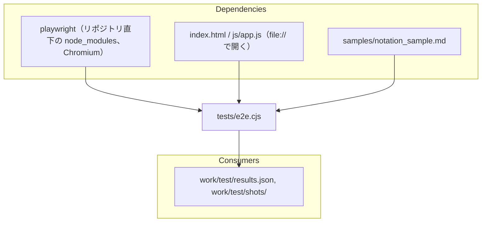

# tests/e2e.cjs

ソース: [tests/e2e.cjs](../../../tests/e2e.cjs)／TC との対応: [doc/4.test_spec/](../../4.test_spec/README.md)（コード中のコメントに TC の ID を書いている）

リポジトリの `package.json` が `"type": "module"` のため、CommonJS の拡張子 `.cjs` にしている。

## 依存関係

## 変更するときの注意

- **`samples/notation_sample.md` への依存**: 図の並び（1 つ目がフローチャート）、数式・フロントマター・大きな図の内容や個数を前提にした判定がある。`samples/notation_sample.md` を変えたら、テストの判定とテスト仕様も見直す。
- **ページ内で実行する関数**: `inspect*` の関数は `page.evaluate` でページ内で実行する。Node.js の変数は参照できないため、必要な値は引数で渡す。
- **アプリのグローバルへの依存**: `state`、`renderApp`、`lastLoadedMarkdown`、`#telemetry-status` の文言、`LuxynoStage` を直接参照している（[js/app.js.md](../js/app.js.md)、[js/stage.js.md](../js/stage.js.md)）。
- **`samples/visual-template.md` への依存**: `TC-LIGHT-*`、`TC-SHOW-*` は、章の番号と図の並び（9 章のフローチャートが 1 つ目、シーケンス図が 4 つ目）を前提にしている。
- **光の確認**: 時刻で変わる光は `LuxynoStage.seekLights()` で止めてから調べる。止めずに撮影すると、画像が実行のたびに変わる。
- **出力の上書き**: 実行すると `work/test/` を上書きする。前回の出力を残す場合は、実行前に別のフォルダへ移す（test スキル）。
- CDN からライブラリを読み込むため、インターネット接続が必要。
