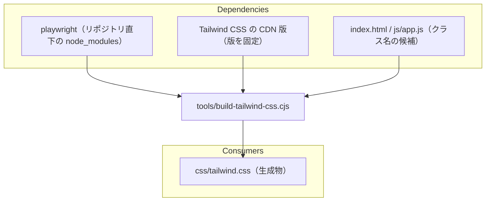

# tools/build-tailwind-css.cjs

ソース: [tools/build-tailwind-css.cjs](../../../tools/build-tailwind-css.cjs)／背景: アーキテクチャ設計書 2 章（Issue #17）

## 依存関係

## 変更するときの注意

- クラス名の候補は、`class="…"` の属性、`className` への代入、`classList` の引数から集める。それ以外の書き方（文字列を組み立てて作るクラス名など）で Tailwind のクラスを使うと、生成から漏れる。
- Tailwind の設定（`fontFamily` の拡張）は、このスクリプトの中にある。フォントなどの設定を変えるときは、ここを直して作り直す。
- 実行には、CDN へのインターネット接続が必要。
