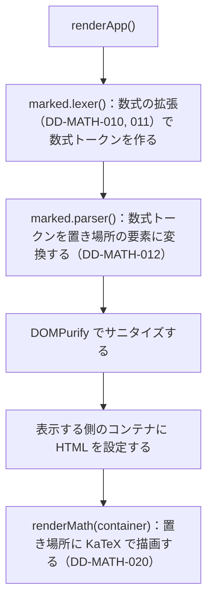

# 数式の描画（math-rendering）

対応する要求: `FR-010`, `NFR-003`（[1.SRS.md](../../1.SRS.md) および [1.SRS/features/math-rendering.md](../../1.SRS/features/math-rendering.md)）／アーキテクチャ: [2.ARCHITECTURE.md](../../2.ARCHITECTURE.md) 4.5

図の中の数式は Mermaid が描画する。後処理は [diagram-rendering.md](diagram-rendering.md) の DD-DIAG-031 を参照する。

## 1. 処理の流れ

## 2. 数式の検出（Marked の拡張）

| ID          | 項目           | 設計                                                                                                                                                                                                                                           | 対応する要求        |          |     |
| :---------- | :------------- | :--------------------------------------------------------------------------------------------------------------------------------------------------------------------------------------------------------------------------------------------- | :------------------ | -------- | --- |
| DD-MATH-001 | 登録           | `marked.use({ extensions: [mathBlock, mathInline] })` で、アプリの起動時に 1 回だけ登録する                                                                                                                                                    | `FR-010`            |          |     |
| DD-MATH-010 | ブロック数式   | ブロックレベルの拡張 `mathBlock`。行頭の `$$` から、`$$` だけの行（または行末の `$$`）までを 1 つのブロック数式とする。正規表現: `^\$\$[^\S\n]*\n?([\s\S]+?)\n?[^\S\n]*\$\$[^\S\n]*(?:\n+\                                                     | $)`                 | `FR-010` |     |
| DD-MATH-011 | インライン数式 | インラインレベルの拡張 `mathInline`。`$$…$$` はディスプレイ数式、`$…$` はインライン数式とする。`$…$` は、開きの直後と閉じの直前が空白でなく、閉じの直後が数字でない場合だけ数式とする。数式の中身にはバッククォートを含めない。正規表現: ``^\$\$((?:\\.\ | [^\\$`])+?)\$\$`` と ``^\$(?!\s)((?:\\.\ | [^\\$`\n])+?)(?<!\s)\$(?!\d)`` | `FR-010` |
| DD-MATH-012 | 置き場所の要素 | ブロック数式は `
…
`、インライン数式は `…`。属性値と中身は HTML エスケープした TeX の原文（`$` を含む）とする | `FR-010`, `NFR-003` |          |     |

- `\$` は、Marked の既定のエスケープ処理（`\` の後の記号を文字にする）で `$` になる。数式の拡張は `\` で始まる位置に一致しないため、追加の処理は不要。
- インラインコード・コードブロック（Mermaid のブロックを含む）は Marked がコードとして先に切り出すため、その中の `$` は数式の拡張にかからない。
- ただし、インラインの拡張は文の前から順に試されるため、コードより前にある `$` から、後ろのインラインコードの中の `$` までを 1 つの数式として拾うおそれがある（例: ``$10 のように `$` は``）。数式の中身にバッククォートを含めないことで防ぐ。TeX の数式でバッククォートを使うことはまれなため、制約として許容する。
- 拡張の `start()` で次の `$` の位置を返し、Marked の通常の文字列処理が `$` を読み飛ばさないようにする。

## 3. 描画

| ID          | 項目             | 設計                                                                                                                                                            | 対応する要求 |
| :---------- | :--------------- | :-------------------------------------------------------------------------------------------------------------------------------------------------------------- | :----------- |
| DD-MATH-020 | `renderMath(container)` | `renderApp()` が表示する側のコンテナに HTML を設定した直後に呼ぶ。コンテナ内の `.lucivo-math` ごとに `katex.render(tex, el, { displayMode, throwOnError: false, trust: false, output: 'htmlAndMathml' })` を呼ぶ | `FR-010`, `NFR-003` |
| DD-MATH-021 | 誤りのある数式   | `throwOnError: false` により、KaTeX は誤りのある数式を、原文と誤りの内容を示す赤字（`.katex-error`）で表示する。他の数式・本文の描画は続ける                    | `FR-010`     |
| DD-MATH-024 | 遅延読み込みとキャッシュ | KaTeX は、置き場所が初めて現れたときに `loadLibrary('katex')` で JavaScript と CSS を読み込み、読み込み後に描画し直す。描画結果は `katex.renderToString()` の結果を TeX と表示形式ごとに `mathCache` に保存し、入力のたびに描画し直さない（Issue #18, #19） | `NFR-006` |
| DD-MATH-022 | KaTeX がない場合 | `window.katex` がない場合は何もしない。置き場所の中身（TeX の原文）がそのまま表示される                                                                         | `FR-010`     |
| DD-MATH-023 | 表示             | ブロック数式は中央寄せで上下に余白を取り、横に長い場合は横スクロールする（`.lucivo-math[data-display="true"]`、`overflow-x: auto`）。文字色は本文の色を継承する | `FR-010`     |

- `trust: false` により、`\href` や `\htmlClass` などの、リンクや任意の属性を生成するコマンドは描画されない（KaTeX の既定）。
- KaTeX の CSS（`katex.min.css`）は `index.html` の `<head>` で読み込む。CSS はフォントを CSS からの相対パスで読み込むため、CDN の同じバージョンの `dist/` から読み込む。
