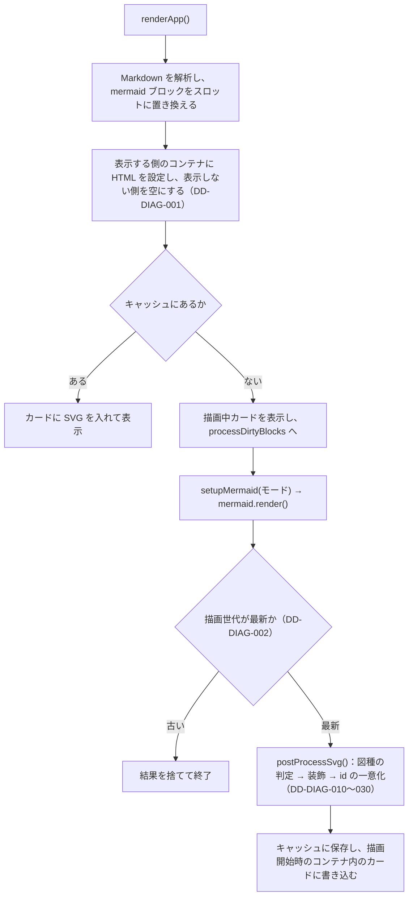

# 図の描画と後処理（diagram-rendering）

対応する要求: `FR-002`, `FR-003`, `FR-008`, `FR-010`, `FR-015`, `NFR-002`, `NFR-004`, `NFR-005`（[SRS.md](../../SRS.md) および [SRS/features/diagram-rendering.md](../../SRS/features/diagram-rendering.md)）／アーキテクチャ: [2.ARCHITECTURE.md](../../2.ARCHITECTURE.md) 4.2・4.3・4.6・4.9

## 1. 描画の流れ

## 2. 描画先の管理

| ID          | 項目                 | 設計                                                                                                                                                  | 対応する要求        |
| :---------- | :------------------- | :---------------------------------------------------------------------------------------------------------------------------------------------------- | :------------------ |
| DD-DIAG-001 | 非表示側の破棄       | `renderApp()` は、表示しない側のコンテナ（高速モードの `#standard-doc-container` または `#visual-stage-container`）の中身を空にする                   | `FR-003`, `NFR-004` |
| DD-DIAG-002 | 描画世代             | `renderApp()` を呼ぶたびに `renderGeneration` を 1 増やし、`processDirtyBlocks()` に描画開始時の世代・コンテナ・モードを渡す。`mermaid.render()` の前後で世代が変わっていれば、結果を DOM にもキャッシュにも反映せずに終了する | `FR-003`, `NFR-002` |
| DD-DIAG-003 | 書き込み先の探索範囲 | 描画結果の書き込み先と、カードのボタン（Fit / 1:1 / PNG / SVG / Expand）の操作対象は、描画開始時のコンテナの中から探す（`document` 全体から探さない） | `FR-003`, `FR-005`  |
| DD-DIAG-004 | 直前の正常描画       | 直前の正常描画（LKG）は、図の番号とモード（`std` / `vis-<スタイル>`）の組で保持する。構文エラーのとき、別のモードの図が表示されないようにするため     | `NFR-002`           |
| DD-DIAG-005 | 拡大表示の後始末     | 拡大モーダルを閉じたら、モーダルに複製した SVG を消す                                                                                                 | `FR-005`            |

- **背景（不具合の原因）**: 以前は表示しない側のコンテナに図が残っていた。このため、`document.querySelector('[data-stage-index=N]')` が非表示側のカードを先に見つけ、Visualモードへの初回の切り替えで、描画結果が非表示の高速モード側に書き込まれていた。その結果、Visualモード側のカードが「描画中」のまま残った。DD-DIAG-001 と DD-DIAG-003 で再発を防ぐ。

## 3. SVG の後処理（`postProcessSvg`）

`aria-roledescription` 属性で図種を判定し、モードに応じて装飾した後、id を一意にする。

| ID          | 項目                     | 設計                                                                                                                                                                                                                      | 対応する要求 |
| :---------- | :----------------------- | :------------------------------------------------------------------------------------------------------------------------------------------------------------------------------------------------------------------------ | :----------- |
| DD-DIAG-010 | id の一意化              | SVG 内のすべての id に SVG 自身の id を接頭辞として付け、属性中の `url(#…)`（`style` 属性の `url("#…")` を含む）、`href` / `xlink:href`、`aria-labelledby` / `aria-describedby` の参照を書き換える。1 つの SVG の中で同じ id が重複する場合（タイムラインの `node-undefined` など）は、2 つ目以降に連番を付け、参照は最初の要素に向けたままにする | `FR-008`, `NFR-004` |
| DD-DIAG-011 | ノード装飾を適用する図種 | `NODE_DECORATED_TYPES`（`flowchart-v2` / `flowchart` / `stateDiagram`）だけに、`g.node` の形・塗りの置き換えとサブグラフの装飾を適用する                                                                                  | `FR-008`     |
| DD-DIAG-012 | シーケンス図の装飾       | シーケンス図には、モードに応じて DD-DIAG-020 と DD-DIAG-021 を適用する                                                                                                                                                    | `NFR-004`    |
| DD-DIAG-013 | マーカーの大きさ         | Visualモードでノード装飾を適用した図は、線幅を基準に拡大されるマーカー（`markerUnits` が既定のもの）を、`viewBox` を付けたうえで `userSpaceOnUse` の固定サイズ（元の 1.6 倍）にする。線を太くすると矢じりが巨大になるため | `FR-008`     |

- **背景（DD-DIAG-010）**: Mermaid は、シーケンス図の矢じり（`#arrowhead`, `#crosshead`, `#filled-head`, `#sequencenumber`）、ER 図の端点、ジャーニー図・タイムラインの矢じりを、図をまたいで同じ id で出力する。同じページに同じ id があると、`url(#…)` は文書中で最初の要素を参照する。参照先が非表示の要素や別の図の要素になると、矢じりやグラデーションが描かれないか、別の図の配色になる。
- **背景（DD-DIAG-011）**: 判定に `aria-roledescription` を使うのは、Mermaid 10.9.1 がすべての図種でこの属性に図種名を出力するため。

## 4. 配色

### DD-DIAG-020 シーケンス図の配色（`NFR-004`）

`styleSequenceDiagram()` で、次の要素の色を指定する。

| 要素                                       | 高速モード                          | Visualモード            |
| :----------------------------------------- | :---------------------------------- | :---------------------- |
| ライフライン（縦の線、破線 `5 4`、1.25px） | Light `#64748B` / Dark `#94A3B8`    | スタイルの `lifeline`   |
| 活性区間の矩形（塗り・枠 1.5px）           | 塗り: パレットの枠線色の半透明（Light 16% / Dark 30%）、枠: パレットの枠線色 | スタイルの `activationBg` / `activationBorder` |
| メッセージ線（2px。応答の破線は `6 4`）    | パレットの線色                      | スタイルの `edgeStroke` |
| 矢じり・番号の円                           | メッセージ線と同じ色                | メッセージ線と同じ色    |
| 番号の文字                                 | Light `#FFFFFF` / Dark キャンバス色 | `#FFFFFF`               |

- ライフラインは、Mermaid 10.9.1 が class を `"200"` で上書きして出力するため、`line[id^="actor"]` と `line[class~="200"]` で選ぶ。
- 応答メッセージ（`-->>`）の破線は意味を持つため、実線に置き換えない。

### DD-DIAG-021 Visualモードの配色（`FR-008`）

- Visualモードは、スタイルごとの配色（Light は `VISUAL_THEMES`、Dark は `VISUAL_THEMES_DARK`）を `setupMermaid(true)` で Mermaid の配色変数に渡す（Dark は DD-DIAG-024）。
- ノード装飾を適用しない図種（クラス図、ER 図、ガント、円グラフ、ジャーニー、4 象限、要求図、Git グラフ、マインドマップ、タイムライン、XY チャート）は、この配色だけで描画する。
- シーケンス図の参加者の箱は、参加者名ごとに色を割り当て、上下の箱を同じ色にする。
- Circles スタイルでは、ひし形・平行四辺形も円形ノードと同じパレットで塗る（白文字を淡い塗りの上に載せないため）。
- Editorial スタイルでは、状態遷移図の並行（fork / join）のバー（高さ 10 以下の矩形）を白で塗らず、Mermaid の線の色のまま残す（白いバーはクリーム色の背景に溶けて見えないため）。
- Circles スタイルで、明るいキャメル色（`#ECB674`、`CIRCLE_DARK_TEXT_FILLS`）の塗りの上の文字は、白ではなく濃い茶色にする（白ではコントラストが足りないため。Issue #21）。
- Cards スタイルの帯はカードの上部に重なるため、ノードのラベルを帯の高さの半分だけ下げ、帯の下の白い部分の中央に置く（Issue #21）。
- ヒーロー（文書の題名）は、`h1` があればその文字、なければ読み込んだファイル名（拡張子なし）を表示し、どちらもなければ出さない。文書と関係のない固定の文言は表示しない（Issue #21）。
- 見出し（ヒーローと各スラブの `h2`）の文字は、`textContent` をエスケープしてから HTML に埋め込む。そのまま埋め込むと、見出しに書いた `&lt;img …&gt;` などが HTML として解釈される（`NFR-003`）。
- Cards スタイルのステップ記号（A, B, C…）は、カード化したノードだけを図の上から順（同じ高さは左から）に付ける。記号は A〜Z の後、AA, AB…と続け、1 つの図の中で重複させない（ノードの多い図で記号が繰り返されると、ステップを識別できないため）。

### DD-DIAG-022 図種別の配色変数（`FR-008`）

派生色に任せると判読できなくなる図種は、`setupMermaid()` で配色変数を明示する。

| 図種           | 配色変数                                                 | 理由                              |
| :------------- | :------------------------------------------------------- | :-------------------------------- |
| ER 図          | `attributeBackgroundColorOdd` / `Even`                   | Dark で属性行が白地に白文字になる |
| ガントチャート | `sectionBkgColor*`, `taskBkgColor`, `taskText*Color`, `activeTask*`, `doneTask*`, `crit*`, `gridColor` | Dark でバーの文字が背景に埋もれる |
| XY チャート    | `xyChart`（背景を透明、軸・文字・系列の色）              | 白地に淡い色の棒になる。Dark で白い板が浮いて見える |
| 円グラフ       | `pieStrokeColor`, `pieOuterStrokeColor`, `pie*TextColor` | 境界線の既定が黒のため、Dark で暗い扇形どうしの境目が見えない |

- ガントチャートは、描画時のページ幅で横長に生成され、表示枠に縮小されて文字が極小になる。このため、`gantt.useWidth` を表示枠に近い 820 にする。

### DD-DIAG-023 空のエッジラベル（`FR-008`）

- ラベルのない矢印にも、Mermaid は空のエッジラベルを図の原点に出力する。`style.css` の `svg .edgeLabel:empty, svg .edgeLabel span:empty` で余白と背景をなくし、小さな図形として見えないようにする。

### DD-DIAG-024 Dark の Visualモード（Issue #13）

- カード背景（`.infographic-bg-<スタイル>`）は、Dark では各スタイルの調子を保った暗い色にする（`style.css`）。
- `VISUAL_THEMES_DARK` は、Light の配色に、背景の上に直接描く線・文字（結線、ラベル、ライフライン、サブグラフ、装飾しない図種のノード）を明るくする共通の値（`VISUAL_DARK_BASE`）と、スタイルごとの派生色（`VISUAL_DARK_ACCENTS`）を重ねたもの。
- 装飾したノードの塗り（色付きの図形・白いカード）と、その上の文字・シーケンス図の参加者の箱の文字は、外観によらず同じ色にする（塗りが明るいまま変わらないため）。
- 装飾で決め打ちしていた結線の色（Shapes・Cards）は配色の `edgeStroke` に、サブグラフの磨りガラスは Dark では暗い半透明にする。シーケンス図の番号は、明るい円の上に載るため暗い色にする。
- PNG の書き出しの背景は、Dark では配色の `canvasBg` にする（明るい文字が白い背景に消えないため）。
- 背景: 以前は外観によらずカードを明るくしていたが、Dark で使う利用者にとってまぶしく、画面の調子がそろわなかった。

## 5. 表示倍率と図の中の数式

| ID          | 項目                 | 設計                                                                                                                                                                                                                                                    | 対応する要求 |
| :---------- | :------------------- | :------------------------------------------------------------------------------------------------------------------------------------------------------------------------------------------------------------------------------------------------------ | :----------- |
| DD-DIAG-030 | `Fit` の縮小の下限   | 図をカードに入れた後に `applyReadableFit(svg)` を呼ぶ。図の中の文字を持つ要素（`text`、`foreignObject` 内の要素）の計算後の文字サイズの最小値 `minFont` を求め、SVG の `min-width` を `viewBox の幅 × min(1, 10 / minFont)` px にする。描画の直後と、キャッシュから表示したときの両方で呼ぶ | `NFR-005` |
| DD-DIAG-031 | シーケンス図の数式のずらし | `styleSequenceDiagram()` で、SVG 直下の `foreignObject`（Mermaid がメッセージの数式を入れる要素）の `y` を 6 小さくする（上へずらす）。文字色を、高速モードはパレットの `nodeText`、Visualモードはスタイルの `nodeText` に指定する                | `FR-010`, `NFR-005` |
| DD-DIAG-033 | 小さな図の拡大の上限 | `applyReadableFit()` は、`viewBox の幅 × MAX_FIT_SCALE（1.5）` を CSS 変数 `--fit-max-width` に設定する。表示枠の CSS は `max-width: min(100%, var(--fit-max-width))` とする（Issue #21）                                                               | `NFR-007`    |
| DD-DIAG-034 | 計算結果のキャッシュ | `applyReadableFit(svg, cacheKey)` は、計算結果（`min-width` と上限）を描画結果のキャッシュのキーごとに `fitCache` に保存する。キャッシュから表示するときは、計算後のスタイルを調べ直さない（Issue #19）                                                 | `NFR-006`    |
| DD-DIAG-032 | 表示枠からはみ出す図 | 図の表示枠（`.diagram-viewport`、`.exhibition-viewport`）は `justify-content: flex-start` とし、表示枠の子要素（SVG、描画中・構文エラーの表示）は左右の `margin` を `auto` にして中央に置く。はみ出す場合は左端から表示し、横スクロールで全体を見られる | `NFR-005`    |

- **背景（DD-DIAG-030）**: `Fit` は SVG の幅を表示枠の幅（100%）にするため、横に大きい図ほど縮小される。CSS では `min-width` が `max-width` より優先されるため、`min-width` で縮小の下限を決められる。`1:1` は既存の `min-width`（`!important`）が優先されるため、この下限の影響を受けない。`min(1, …)` により、下限で元の大きさより大きくすることはない。
- **背景（DD-DIAG-031）**: Mermaid `10.9.1` は、数式の `foreignObject` の下端をメッセージ線の位置にそろえて配置する。和の記号の添字や分数の分母が線に接し、重なって見えるため。6 は、線の太さ（2px）と、文字と線の間に必要な余白から決めた値。また、数式（MathML）はページの文字色を継承するため、Visualモードの Dark では、明るいカードの上に白い文字で描かれて見えなくなる。このため文字色も指定する。
- **背景（DD-DIAG-032）**: 表示枠は `justify-content: center` で SVG を中央に置いていた。この状態で SVG が表示枠より広くなると、左右へ均等にはみ出し、左側がスクロールでも見えない位置になる。左右の `margin: auto` は余白があるときだけ中央に置き、はみ出すときは 0 になる。ただし、`margin: auto` が 0 になった場合は `justify-content` が効くため、`margin: auto` だけでは解決せず、`justify-content` を `flex-start` にする必要がある（テストで確認した）。

## 6. Visualモードの自動 2 段組みレイアウト

| ID          | 項目                                      | 設計                                                                                                                                                                                                                                                                                                                                       | 対応する要求        |
| :---------- | :---------------------------------------- | :----------------------------------------------------------------------------------------------------------------------------------------------------------------------------------------------------------------------------------------------------------------------------------------------------------------------------------------- | :------------------ |
| DD-DIAG-040 | 2 段組み対象スラブの構築                  | `buildVisualStageHtml()` でスラブの要素群を調べ、`.luxyno-slot` がちょうど 1 つあり、かつ `h2`・`.front-matter`・`.luxyno-slot` 以外の要素ノード（本文要素）が 1 つ以上ある場合は、スラブに `.exhibition-slab-split` を付け、`h2`（および先頭の `.front-matter`）の下に `

…

…

` を出力する | `FR-015` |
| DD-DIAG-041 | 2 段組みの CSS グリッド                   | `.exhibition-slab-split > .exhibition-slab-body` は CSS Grid（左 `minmax(15rem, 5fr)`、右 `minmax(0, 7fr)`、`align-items: start`）で横並びにする。`.is-stacked` が付いた場合と画面幅 `767px` 以下の場合は `grid-template-columns: 1fr`（縦積み 1 段）にする                                                                                | `FR-015`, `NFR-007` |
| DD-DIAG-042 | 幅超過時の 1 段組みへの自動フォールバック | `applyReadableFit()` の直後、図の倍率切替（`Fit` / `1:1`）時、ビューモード切替（`Split` / `Canvas`）時、およびウィンドウの `resize` 時に `updateSlabSplit()` を呼ぶ。いったん `.is-stacked` を外した状態で `.exhibition-viewport` の `scrollWidth > clientWidth + 1` であれば、右カラム幅に図が収まらないと判定して `.is-stacked` を付ける | `FR-015`, `NFR-005` |

- **背景（DD-DIAG-040）**: 先頭スラブに `.front-matter` が含まれる場合、`.front-matter` を `.exhibition-slab-body` の外（スラブの先頭子要素）に置くことで、フロントマターが常にスラブ最上部に全幅表示される設計（`DD-FM-030`）と両立させる。
- **背景（DD-DIAG-042）**: 固定のノード数や `viewBox` 幅の閾値だけで判定すると、文字の大きさや画面幅（`Split` と `Canvas` の差）によって、右カラム内で横スクロールが出る図や、逆に収まるのに 1 段になる図が出る。`applyReadableFit()` が設定した `min-width` のもとで実際の `scrollWidth > clientWidth + 1` を調べることで、`NFR-005`（10px 下限）と完全に一致した判定ができる。また `getComputedStyle` を呼ばないため、`TC-PERF-002` のキャッシュ再描画条件（`getComputedStyle` 呼び出し 0 回）も維持される。
