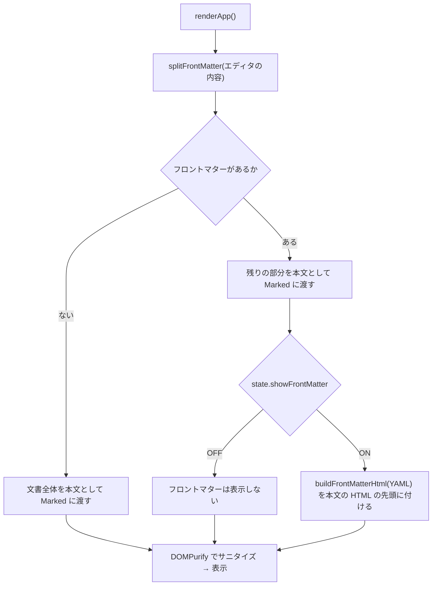

# YAML フロントマター（front-matter）

対応する要求: `FR-011`, `NFR-003`, `NFR-006`（[SRS.md](../../SRS.md) および [SRS/features/front-matter.md](../../SRS/features/front-matter.md)）／アーキテクチャ: [2.ARCHITECTURE.md](../../2.ARCHITECTURE.md) 4.7

## 1. 処理の流れ

## 2. 設計

| ID        | 項目               | 設計                                                                                                                                                                                                                                                     | 対応する要求 |     |     |
| :-------- | :----------------- | :------------------------------------------------------------------------------------------------------------------------------------------------------------------------------------------------------------------------------------------------------- | :----------- | --- | --- |
| DD-FM-001 | 切り出し           | `splitFrontMatter(text)` は、正規表現 `^---[ \t]*\r?\n(?:([\s\S]*?)\r?\n)?(?:---\                                                                                                                                                                        | \.\.\.)[ \t]*(?:\r?\n\ | $)` で文書の先頭だけを調べる。一致したら `{ yaml, body }`（`body` は一致した部分より後ろ）、一致しなければ `{ yaml: null, body: text }` を返す | `FR-011` |
| DD-FM-002 | 空のフロントマター | `---` と `---` の間が空の場合も、フロントマターとして切り出す（中身が空の枠を表示する）                                                                                                                                                                  | `FR-011`     |     |     |
| DD-FM-010 | 表示の状態         | `state.showFrontMatter`（初期値 `false`）で保持する。モードの切替では変えない                                                                                                                                                                            | `FR-011`     |     |     |
| DD-FM-011 | 切替ボタン         | ヘッダー右側に `#btn-front-matter`（表示は「YAML」、`aria-pressed`）を置く。押すと `state.showFrontMatter` を反転し、`aria-pressed` と見た目（`is-active`）を更新して `renderApp()` を呼ぶ                                                               | `FR-011`     |     |     |
| DD-FM-020 | 表示の HTML        | `buildFrontMatterHtml(yaml)` は `<section class="front-matter">
Front Matter
<pre class="front-matter-body"><code>…</code></pre></section>` を返す。`code` の中は行ごとに DD-FM-021 で色分けした HTML を改行でつなぐ | `FR-011`     |     |     |
| DD-FM-021 | 色分け             | 行ごとに、コメント行（`#` で始まる）→ `span.fm-comment`、キーの行（`キー:` の形。先頭の `- ` を含んでもよい）→ キーを `span.fm-key`、値を `span.fm-value`、それ以外の行（複数行の値の続きなど）→ `span.fm-value` とする。行の字下げはそのまま残す。各部分は `escapeHtml` でエスケープしてから `span` で囲む | `FR-011`, `NFR-003` |  |  |
| DD-FM-022 | サニタイズ         | 本文の HTML の先頭に付けてから、本文と一緒に DOMPurify でサニタイズする（`class` は許可済み）                                                                                                                                                            | `NFR-003`    |     |     |
| DD-FM-030 | 見た目             | 枠は本文の前に置き、背景 `--panel-sub`、枠 1px `--border-strong`、角丸 10px。ラベル「Front Matter」は等幅・大文字・`--text-muted`。キーは `--accent`、値は `--text-primary`、コメントは `--text-muted` で斜体にしない                                    | `FR-011`     |     |     |

- **背景（DD-FM-001）**: 文書の途中の `---` を誤ってフロントマターにしないよう、文書の先頭だけを調べる。閉じの行がない場合に一致させないのは、先頭の水平線（`---` の後に本文が続く文書）を誤って隠さないため。
- **背景（DD-FM-021）**: YAML の完全な解析はしない（アーキテクチャ 4.7）。行単位の色分けでも、キー・値・コメントを見分ける目的には足りる。色分けの誤り（たとえば値の中の `:`）は、表示の色が変わるだけで、内容は書いたとおりに表示される。
- Visualモードでは、フロントマターの枠は最初のスラブ（最初の `h2` より前の内容）に入る。`h1` はヒーローに移るため、枠はスラブの先頭に表示される。
