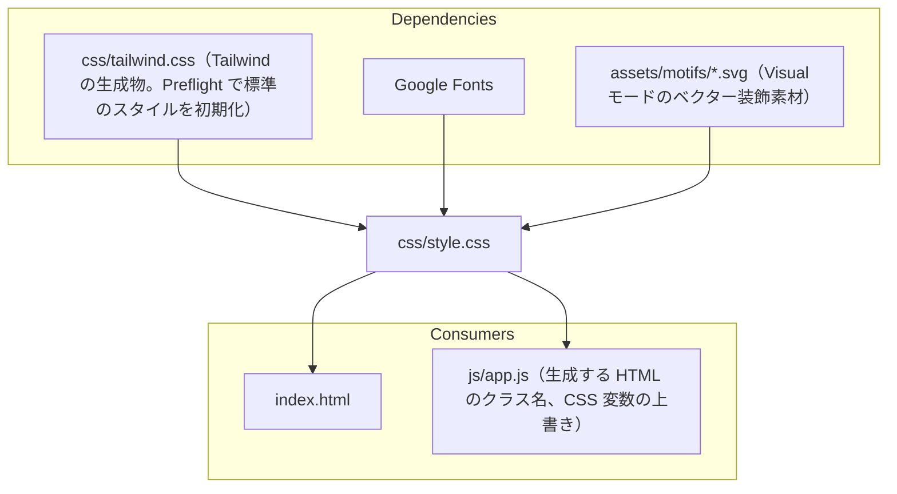

# css/style.css

ソース: [css/style.css](../../../css/style.css)／設計: `DD-MD`、`DD-DIAG-023`・`030`〜`032`・`041`、`DD-MATH-023`、`DD-FM-030`、`DD-FILE-006`、`DD-VTPL-020`〜`031`

## 依存関係

## 変更するときの注意

- **初期化されたスタイル**: Tailwind の Preflight と、本ファイルの `* { margin: 0; padding: 0; }` で、ブラウザ標準のスタイルは消えている。新しく表示する要素には、余白や見た目を明示する（`DD-MD-001`）。
- **読み込み順**: `index.html` で `tailwind.css` より後に読み込むため、同じ詳細度なら本ファイルが優先される。`tailwind.css` は生成物のため直接編集しない。
- **本文の要素**: 高速モードと Visualモードの両方に効くよう `:is(.prose-doc, .exhibition-slab)` で書く。
- **線の色**: 背景と見分ける線には `--border-strong` を使う。Dark の Visualモードでは `--border-subtle` がスラブの背景と同じ色になる（`DD-MD-003`）。
- **図の表示枠**: `justify-content` は `flex-start` のままにし、中身は左右の `margin: auto` で中央に置く。`center` に戻すと、表示枠より広い図の左側がスクロールで見えなくなる（`DD-DIAG-032`）。
- **クラス名の出どころ**: `luxyno-math`、`front-matter`、`fm-*`、`edge-curve-btn`、`exhibition-slab-split`、`is-stacked`、`vs-*`、`has-spotlight`、`is-spotlight`、`is-reached`、`has-stage-focus`、`is-stage-focused` などは `app.js` が、`signal-light-canvas`、`has-signal-light`、`is-stage-show`、`is-scene`、`is-built`、`is-building`、`stage-*` は `stage.js` が生成・付与するクラス名で、HTML ファイルには現れない。
- **ベクター装飾素材の着色と `file://` 対応**: `assets/motifs/*.svg`（`AST-005`〜`009`）は CSS の `mask` / `-webkit-mask` で読み込み、`background`（`--vs-c` や `--vs-c1〜4`）で着色する（`DD-VTPL-024`）。Chromium で `file://` から開くと `mask-image: url('../assets/...')` が CORS エラーになるため、`.exhibition-wrap` の `--motif-*` に同一の SVG を `data:image/svg+xml` で定義して参照する。`blockquote.vs-quote::before` は `content: "\201C"` を保ったまま `color: transparent` にして `quote-watermark.svg` をマスク表示する（`TC-VTPL-006` が `::before` の `content` を検査するため）。
- **手順の接続線と光**: `.vs-steps::before` はベースの線だけとし（`TC-VTPL-008` の接続線のコントラストの検査が `backgroundColor` を見る）、光は `.vs-steps::after` に描く。`li` に `z-index: 1` を付けて丸を光の前に出す。`--vs-cycle` と光の走る割合 70% は、`vs-comet-run` のキーフレームの `70%` と `--vs-i` の遅延に関係するため、まとめて変える（`DD-LIGHT-030`〜`031`）。
- **発表中の拡大**: `html.is-stage-show` の `font-size` で誌面全体を拡大する。ここに `px` で書いた寸法は拡大されない（`DD-SHOW-003`）。
- **雛形の値の正**: 雛形（`.vs-*`）の寸法・色は、デザイン仕様（[0.DTP/features/visual-templates.md](../../0.DTP/features/visual-templates.md)）を正とする。値を変えるときは、先にデザイン仕様を直す。
- **コンテナクエリの基準**: `.exhibition-wrap` は `container-type: inline-size` のコンテナで、雛形の `@container` はその幅（版面の幅）で判定する。`.exhibition-wrap` の幅を中身に合わせる指定（`width: max-content` など）にすると、コンテナの大きさが決まらなくなる（`DD-VTPL-022`）。
