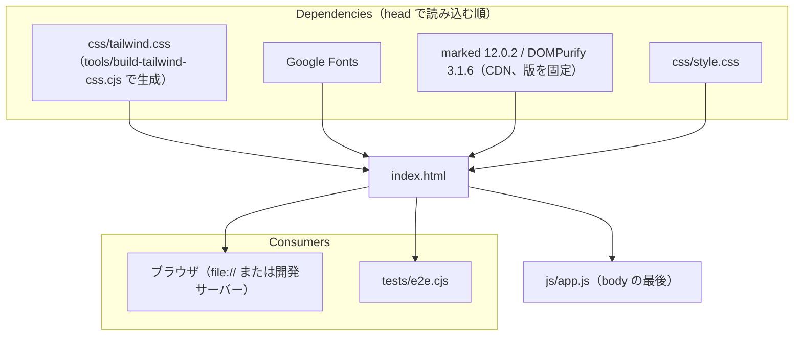

# index.html

ソース: [index.html](../../index.html)／設計: `DD-FILE-001`〜`006`、`DD-FM-011`、アーキテクチャ 4.5

## 依存関係

## 変更するときの注意

- **要素の id**: `app.js` と `tests/e2e.cjs` が id で参照している。id を変えるときは、両方を検索して直す。
- **head に書かないライブラリ**: Mermaid と KaTeX は、`app.js` の `LIBRARIES` が必要になったときに読み込む（版もそこで固定している）。
- **CDN の版**: SVG の後処理の多くが Mermaid の出力の構造（class 名、id、要素の並び）に依存している。版を上げるときは、テストを全件実行し、図の画像を目視で確認する。
- **HTML エクスポート**: `document.documentElement.outerHTML` を書き出すため、`<head>` の読み込み（KaTeX の CSS など）は書き出した HTML にもそのまま入る。
