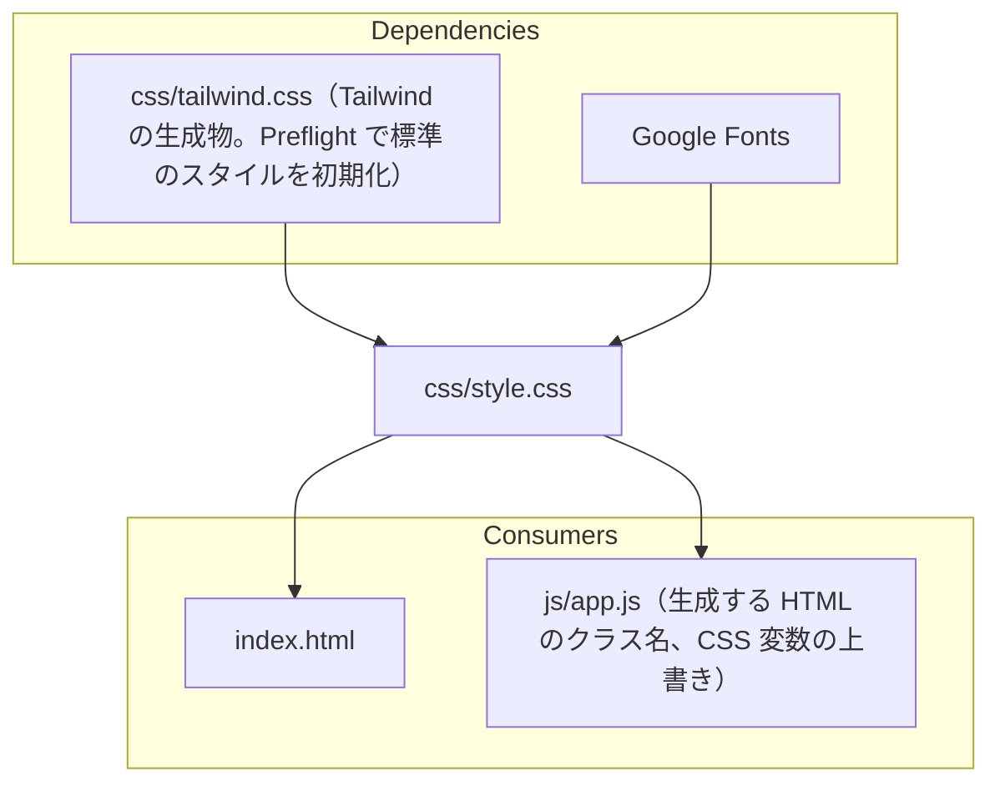

# css/style.css

ソース: [css/style.css](../../../css/style.css)／設計: `DD-MD`、`DD-DIAG-023`・`030`〜`032`・`041`、`DD-MATH-023`、`DD-FM-030`、`DD-FILE-006`

## 依存関係

## 変更するときの注意

- **初期化されたスタイル**: Tailwind の Preflight と、本ファイルの `* { margin: 0; padding: 0; }` で、ブラウザ標準のスタイルは消えている。新しく表示する要素には、余白や見た目を明示する（`DD-MD-001`）。
- **読み込み順**: `index.html` で `tailwind.css` より後に読み込むため、同じ詳細度なら本ファイルが優先される。`tailwind.css` は生成物のため直接編集しない。
- **本文の要素**: 通常モードと Visual Stage の両方に効くよう `:is(.prose-doc, .exhibition-slab)` で書く。
- **線の色**: 背景と見分ける線には `--border-strong` を使う。Dark の Visual Stage では `--border-subtle` がスラブの背景と同じ色になる（`DD-MD-003`）。
- **図の表示枠**: `justify-content` は `flex-start` のままにし、中身は左右の `margin: auto` で中央に置く。`center` に戻すと、表示枠より広い図の左側がスクロールで見えなくなる（`DD-DIAG-032`）。
- **クラス名の出どころ**: `luxyno-math`、`front-matter`、`fm-*`、`edge-curve-btn`、`exhibition-slab-split`、`is-stacked` などは `app.js` が生成・付与するクラス名で、HTML ファイルには現れない。
