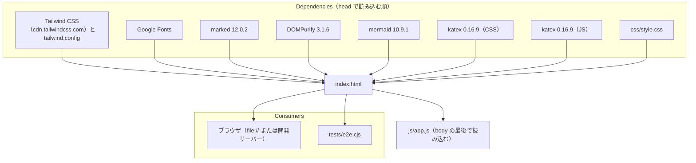

# index.html

ソース: [index.html](../../index.html)

## 1. 依存関係

- CDN のバージョンは固定している。更新するときは、テスト（`tests/e2e.cjs`）を全件実行して見た目を確認する（Mermaid の出力の構造に依存する後処理が多いため）。
- `style.css` は Tailwind より後に読み込み、同じ詳細度のときに優先されるようにする。
- HTML エクスポート（`btn-export-html`）は `document.documentElement.outerHTML` を書き出すため、`<head>` の読み込みはそのまま書き出した HTML にも含まれる（アーキテクチャ 4.5）。

## 2. 主な要素

| 領域         | 主な id                                                                 | 役割                                                    | 対応する設計 ID / 要求 |
| :----------- | :---------------------------------------------------------------------- | :------------------------------------------------------ | :--------------------- |
| ヘッダー     | `btn-file-menu`, `file-menu`, `menu-open-markdown`, `file-input`        | ファイルメニューと非表示のファイル選択                  | `DD-FILE-001`〜`003`   |
|              | `btn-visual-mode`, `btn-theme-toggle`, `btn-open-settings`, `btn-export-html` | Visual Stage の切替、Light / Dark、パレット設定、HTML エクスポート | `FR-003`, `FR-004`, `FR-005` |
| ヘッダー中央 | `.view-mode-btn[data-view-mode]`                                        | `Split` / `Canvas` / `Code` の切替                      | `FR-001`               |
| スタイルバー | `.info-style-btn[data-info-style]`, `.curve-option-btn[data-curve-set]` | Visual Stage のスタイル、矢印形状                       | `FR-003`, `FR-004`     |
| エディタ     | `pane-editor`, `markdown-editor`, `btn-test-cache`, `btn-test-err`      | Markdown の入力、キャッシュ・エラー耐性の動作確認ボタン | `FR-001`, `NFR-002`    |
| プレビュー   | `pane-preview`, `preview-scroll`, `standard-doc-wrapper`, `standard-doc-container`, `visual-stage-container` | 通常モードと Visual Stage のプレビュー（表示するのは常に片方） | `DD-DIAG-001` |
| 状態表示・通知 | `telemetry-pill`, `telemetry-status`, `toast`, `toast-message`        | 図の描画状態（`Rendering … diagrams...` / `… Diagrams Ready` / `All Diagrams Verified`）、トースト | `NFR-002` |
| モーダル     | `settings-modal`, `zoom-modal`, `zoom-canvas`, `zoom-close-btn`         | パレット設定、図の拡大表示                              | `FR-004`, `DD-DIAG-005` |
