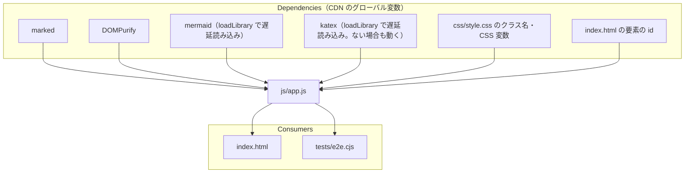

# js/app.js

ソース: [js/app.js](../../../js/app.js)／設計: [3.detailed_design/](../../3.detailed_design/README.md) の全 feature（FILE, DIAG, MD, MATH, FM, EDGE）

ビルドなしで `file://` から動かすため（`NFR-001`）、モジュールに分けない単一のスクリプトで、関数と状態はグローバルに置いている。

## 依存関係

## 変更するときの注意

- **テストからの間接的な依存**: `tests/e2e.cjs` は、ページ内のグローバルな `state`・`renderApp`・`lastLoadedMarkdown` と、`#telemetry-status` の文言（`Rendering` を含むかどうかで描画の完了を判定）を直接参照する。名前や文言を変えるときはテストも直す。
- **CSS との間接的な依存**: 生成する HTML のクラス名（`luxyno-math`、`front-matter`、`fm-*`、`edge-curve-btn`、`exhibition-*` など）は `style.css` が前提にしている。`--accent` などの CSS 変数は `syncCssTokens()` がパレットに合わせて上書きする。
- **描画結果のキャッシュのキー**: 図の SVG は、Mermaid のコードと見た目に関わる設定（外観、パレット、矢印の形状、スタイル、モード）のハッシュをキーにキャッシュする。図の見た目に影響する設定を追加したら、キーにも含める。含めないと、設定を変えても古い図が表示される。
- **要素の探索範囲**: 図のカードの要素は、表示中のコンテナの中だけから探す。`document` 全体から探すと、別のモードの同じ番号のカードを拾う（`DD-DIAG-003`）。
- **DOM に入れる前と後**: `postProcessSvg()` は文書に入れていない要素を処理するため、計算後のスタイルや大きさは取れない。それらが必要な処理は `applyReadableFit()`（およびその中の `updateSlabSplit()`）のように DOM に入れた後に行う。キャッシュから表示するたびにも呼ぶ。
- **サニタイズの順序**: 本文とフロントマターの HTML は DOMPurify を通してから DOM に入れる。KaTeX の数式だけは、サニタイズ後に置き場所へ描画する（KaTeX の出力はサニタイズで崩れるため、`DD-MATH-020`）。
- **遅延読み込み**: `window.mermaid` / `window.katex` は、図・数式が現れるまで存在しない。`setupMermaid()` は Mermaid がなければ何もしないため、描画の直前（`processDirtyBlocks()` で `loadLibrary('mermaid')` を待った後）に呼ぶ。
- **Mermaid の `securityLevel`**: `strict` にしている（Issue #23）。`loose` に戻すと、開いた Markdown の図の中の HTML とクリック時のスクリプト呼び出しが有効になる。
- **Tailwind のクラス**: 生成する HTML で新しい Tailwind のクラスを使ったら、`tools/build-tailwind-css.cjs` で `css/tailwind.css` を作り直す。
- **Mermaid の設定は描画ごと**: `mermaid.initialize()` はグローバルな設定のため、図ごとに異なる設定（モード、矢印の形状）は、各図の `mermaid.render()` の直前に `setupMermaid()` で設定し直している。
