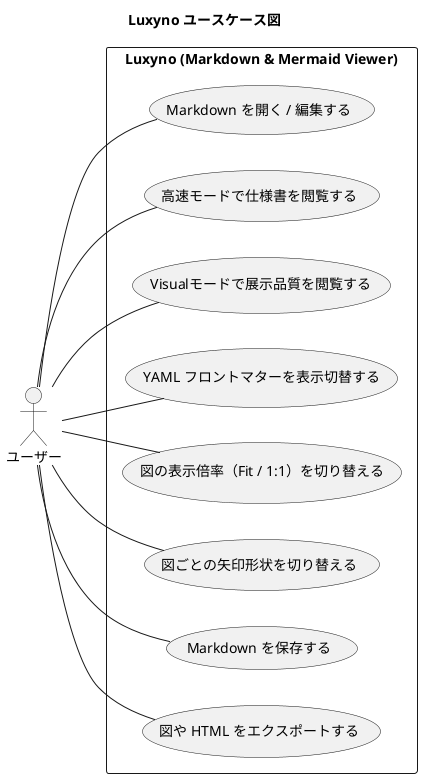
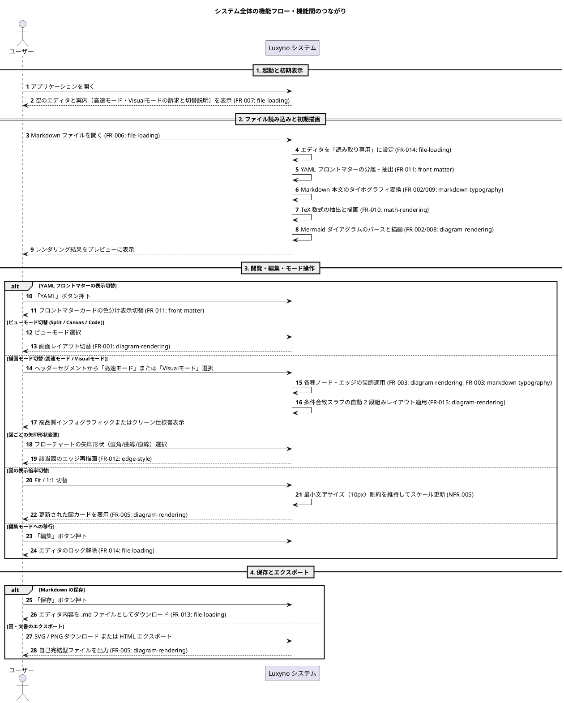

# ソフトウェア要求仕様書 (SRS: Software Requirement Specification)

## 1. 概要

**Luxyno — Exhibition-Grade Markdown Viewer** は、Markdown 文書と Mermaid ダイアグラムを表示・エクスポートするスタンドアロンの Web アプリケーション（Markdown ビューアー）である。
エンジニアリング仕様書向けのクリーンな「高速モード」と、インフォグラフィック調の 4 スタイルでトップデザイナーレベルのデザインに変換できる「Visualモード」を備える。

- 製品の位置づけは Markdown ビューアーである。エディタ（左ペインでの編集とリアルタイムのプレビュー）は付随的な機能とし、要求の優先度はビューアーとしての表示・閲覧の機能より低い。

### 1.1 プロダクトコンセプト

要求の追加・変更や設計の判断は、本節のコンセプトに照らして行う。

**差別化のポイント**
- 既存の Markdown / Mermaid ビューアーより軽快に動作すること。
- モード切替により対象ドキュメントの表示をトップデザイナーレベルのデザインに変換できること。

**2 つのモードの位置づけ**

| モード       | 最優先すること                               | 目指す水準 |
| :----------- | :------------------------------------------- | :--------- |
| 高速モード   | 軽快に動作すること（至上命題）               | 起動から、その後の編集・閲覧の操作まで、すべての場面で待たされない |
| Visualモード | 見た目の品質。閲覧操作のリアルタイム性は保つ | 各種イベントやショーの講演資料・展示素材として、そのまま表示できる。簡易ビューアーで描画していると感じさせない、トップデザイナーが制作したと思える品質。全体の構図から細部の質感までこだわる |

**判断の指針**
- 高速モードで、速度と見た目・機能が衝突するときは、速度を優先する。起動時の読み込みや、入力のたびに行う処理を増やす変更は、その費用を評価してから採る。
- Visualモードで、品質と速度が衝突するときは、品質を優先する。品質のために、起動（Visualモードへの切り替え、スタイルの切り替えによる描画）や Publishing の操作（画像・HTML の書き出しを含む、発表用に整える操作全般）が重くなるのは許容する。ただし、閲覧の操作（スクロール、図の表示倍率の切替、拡大表示など）は、講演・展示の進行に支障が出ない程度のリアルタイム性を保つ。

### 1.2 ブランドコンセプト（Luxyno — Brand Concept Sheet）

**Luxyno — Exhibition-Grade Markdown Viewer**（読み：ルキシノ）

本節は、1.1 のプロダクトコンセプトを表現するブランドの定義である。製品名・ロゴ・配色などの表現は本節に従う。

- 製品名は、画面の表示・`<title>`・フォルダ名（`public/standalone-apps/luxyno/`）・ドキュメント・コード上の名前（クラス名など）のすべてで Luxyno を使う。
- 1.2.5 のビジュアル展開（ロゴ、シンボルマーク、ブランドカラー）の画面への反映は順次進める。
- ブランドカラー（ダーク基調）は、ブランドの表現（ロゴ、アプリの外枠など）に使う。Visualモードの図・カードの配色をブランドカラーに合わせる必要はない（Visualモードの配色は、4 スタイルそれぞれのデザインに従う）。

#### 1.2.1 ネーミングの構造と音韻設計（Phonetics & Origin）
- **語源の核**: `Lux`（ラテン語：光・輝き・照度） ＋ `-yno`（端正な佇まい・完結性を生む現代的サフィックス）
- **音の構成**:
  - 立ち上がりの **「Lu-」**：滑らかで淀みのない母音の抜け。思考を妨げない軽快性とノーストレスな書き味を表現。
  - 中央の鋭利な **「-x-」**：エンジニアリングの厳密さ、Mermaid 記法が持つ構造化のシャープなエッジ。
  - 結びの **「-yno」**：イタリア語・ラテン語調の落ち着いた調和。ツールとしての安定感と、展示・カンファレンスにふさわしい洗練された品格。
- **アイデンティティ**: 既存の英単語や陳腐化したテック接尾辞に依存しない完全な造語であり、Web およびグローバルソフトウェア領域において濁りのないクリーンな認知を確立。

#### 1.2.2 コア・フィロソフィー（Philosophy）
> **「構文に、光と舞台を。」**  
> 単なるプレーンテキストの変換器ではなく、エンジニアが紡ぐロジックの構造美を、そのままスポットライトの当たるステージへと引き上げる。

開発者が日常的に求める「極めて軽快な動作」を基盤に敷きながら、ひとたびモードを切り替えれば、そのまま各種イベント、基調講演、展示ブースの大画面で主役を張れるクオリティを創出する。

#### 1.2.3 デュアルモードの体験設計
- **高速モード（Fast Mode）── 思考を邪魔しない絶対的軽快性**: 一切のラグや無駄な装飾を排し、ミリ秒単位でレスポンスする高速レンダリング環境。Markdown と Mermaid を素早く打ち込み、思考のスピードでアイデアを具現化する（`NFR-006`）。
- **Visualモード（Visual Mode）── トップデザイナーレベルのプロ品質**: ノードの配置バランス、タイポグラフィのカーニング、微細なシャドウ、線と光の陰影処理までを極限までチューニング。「Lux（光）」の名が示す通り、大画面で映える立体感と洗練されたトーン＆マナーで、発表者とプロダクトの信頼性を最大限に引き上げる（`NFR-007`）。

#### 1.2.4 タグラインが約束する提供価値
**— Exhibition-Grade Markdown Viewer —**
- **Exhibition-Grade（展示会・展示素材品質）**: モーターショー、テックカンファレンス、デザインエキシビションなどの**最高峰の舞台にそのまま掲出できる基準**を満たしていることを宣言。
- **Markdown Viewer**: ベースが極めて直感的かつオープンな Markdown / Mermaid 記法であることを明示し、開発者やテクニカルライターが学習コストゼロで導入できる道具としての誠実さを担保。

#### 1.2.5 ビジュアル展開の指針（Visual Tone & Style）
- **ロゴ表記**: `LUXYNO`（オールキャップスで硬質な信頼感）または `Luxyno`（幾何学的サンセリフによるミニマルモダン）
- **シンボルマーク**: 「L」と「X」の交差、あるいは光のプリズム・ノードの結節点をモチーフにした、ソリッドで抽象度の高いアイコン
- **ブランドカラー**: 深みのあるダークスレート／オブシディアンブラックを基調に、冷涼で純度の高いアクセントライト（ペールシアン、ルミナスホワイト）

---

## 2. アクターとユースケース

### 2.1 アクター

| アクター | 説明                                                                                 |
| :------- | :----------------------------------------------------------------------------------- |
| ユーザー | Markdown および Mermaid 記法で仕様書・設計書・インフォグラフィックを作成・閲覧する人 |

### 2.2 ユースケース図

---

## 3. システム全体の機能フロー・機能間のつながり

本節は、Luxyno における主要機能群（各 feature）がユーザー操作を通じてどのように連携するかを示す全体シーケンスである。

---

## 4. 機能要求 (FR) 一覧と feature 要求仕様書への索引

各機能要求の詳細な仕様、背景・根拠、採らなかった案については、リンク先の各 Feature Requirement Specification を参照する。

| ID     | 機能名                     | 担当 feature                                | 概要                                                                                                             | 詳細要求仕様書                                                                    |
| :----- | :------------------------- | :------------------------------------------ | :--------------------------------------------------------------------------------------------------------------- | :-------------------------------------------------------------------------------- |
| FR-001 | ビューモード切替           | `diagram-rendering`                         | `Split`（エディタ＋プレビュー）、`Canvas`（プレビューのみ）、`Code`（エディタのみ）の 3 モードを切り替える       | [diagram-rendering.md](SRS/features/diagram-rendering.md#fr-001-ビューモード切替) |
| FR-002 | 高速モード（仕様書表示）   | `diagram-rendering` / `markdown-typography` | Markdown と Mermaid 図をフラットで高密度なエンジニアリング仕様書スタイルで描画する                               | [diagram-rendering.md](SRS/features/diagram-rendering.md#fr-002-高速モード仕様書表示におけるダイアグラムデザイン) / [markdown-typography.md](SRS/features/markdown-typography.md#fr-002--fr-003-ドキュメントシート外観) |
| FR-003 | Visualモード               | `diagram-rendering` / `markdown-typography` | ヘッダーのセグメントから「高速モード」「Visualモード」を直接切り替え可能とする。Visualモードでは文書と Mermaid 図を 4 種のインフォグラフィックスタイル（Pastel Shapes / 2-Tier Cards / Vibrant Circles & Dots / Editorial Cream）で描画する | [diagram-rendering.md](SRS/features/diagram-rendering.md#fr-003-visualモードインフォグラフィック-4-スタイル) / [markdown-typography.md](SRS/features/markdown-typography.md#fr-002--fr-003-ドキュメントシート外観) |
| FR-004 | テーマ・パレット切替       | `edge-style`                                | Light / Dark 外観切替、4 種のカラーパレット（Cobalt / Emerald / Amber / Royal）を切り替える                      | [edge-style.md](SRS/features/edge-style.md#fr-004-テーマパレット切替)             |
| FR-005 | 図の個別操作・エクスポート | `diagram-rendering`                         | 各ダイアグラムカードの拡大表示（Expand）、表示倍率切替（Fit / 1:1）、SVG・PNG ダウンロード、HTML エクスポートを行う | [diagram-rendering.md](SRS/features/diagram-rendering.md#fr-005-図の個別操作エクスポート) |
| FR-006 | Markdown ファイルの読み込み | `file-loading`                             | ヘッダーの「ファイル」メニューからローカルファイルをエディタに読み込み、プレビューを更新する                     | [file-loading.md](SRS/features/file-loading.md#fr-006-markdown-ファイルの読み込み) |
| FR-007 | 起動時の初期表示           | `file-loading`                              | 起動直後のエディタは空とし、プレビューに差別化ポイント（高速モード・Visualモード）と切替方法を含む案内を表示する | [file-loading.md](SRS/features/file-loading.md#fr-007-起動時の初期表示)           |
| FR-008 | 同梱サンプルの全図種の描画 | `diagram-rendering`                         | 同梱の `sample.md` に記載したすべての図を、高速モードと Visualモードの 4 スタイルの両方で意図どおりに描画する    | [diagram-rendering.md](SRS/features/diagram-rendering.md#fr-008-同梱サンプルの全図種の描画) |
| FR-009 | 同梱サンプルの Markdown 記法の描画 | `markdown-typography`               | 同梱の `sample.md` に記載したすべての Markdown 記法を、高速モードと Visualモードの 4 スタイルの両方で見分けられるように描画する | [markdown-typography.md](SRS/features/markdown-typography.md#fr-009-同梱サンプルの-markdown-記法の描画) |
| FR-010 | 数式の描画                 | `math-rendering`                            | 本文のインライン・ブロック TeX 数式、およびフローチャート・シーケンス図のラベル内の数式を描画する                | [math-rendering.md](SRS/features/math-rendering.md#fr-010-数式の描画)             |
| FR-011 | YAML フロントマターの表示  | `front-matter`                              | 文書先頭の YAML フロントマターを本文と分離し、表示の ON / OFF 切替およびシンタックスハイライトを行う             | [front-matter.md](SRS/features/front-matter.md#fr-011-yaml-フロントマターの表示)  |
| FR-012 | 図ごとの矢印の形状         | `edge-style`                                | 矢印の形状（曲線 / 直角 / 直線）を図ごとに選べるようにする                                                       | [edge-style.md](SRS/features/edge-style.md#fr-012-図ごとの矢印の形状)             |
| FR-013 | Markdown の保存            | `file-loading`                              | 「保存」ボタンでエディタの内容を Markdown ファイルとしてダウンロードする                                         | [file-loading.md](SRS/features/file-loading.md#fr-013-markdown-の保存)            |
| FR-014 | 読み込み直後の読み取り専用 | `file-loading`                              | ファイルを読み込んだ直後はエディタを読み取り専用にし、「編集」ボタンで解除する                                   | [file-loading.md](SRS/features/file-loading.md#fr-014-読み込み直後の読み取り専用) |
| FR-015 | Visualモードの自動 2 段組みレイアウト | `diagram-rendering`              | Visualモードのスラブに本文と 1 つの Mermaid 図が含まれ、図が収まる場合は左右 2 段組みで表示する                  | [diagram-rendering.md](SRS/features/diagram-rendering.md#fr-015-visualモードの自動-2-段組みレイアウト) |
---

## 5. 非機能要求 (NFR)

| ID      | 項目                   | 内容                                                                        |
| :------ | :--------------------- | :-------------------------------------------------------------------------- |
| NFR-001 | スタンドアロン動作     | バックエンド API を必要とせず、ブラウザのみで完結して動作する               |
| NFR-002 | キャッシュとエラー耐性 | FNV-1a ハッシュによる SVG キャッシュで再描画を高速化し、構文エラー時は直前の正常描画（LKG）を保持する |
| NFR-003 | セキュリティ           | Markdown から生成した HTML は DOMPurify でサニタイズしてから DOM に反映する |
| NFR-004 | 図の視認性             | シーケンス図のライフラインや矢じりは、高速モード・Visualモードの 4 スタイル・Light / Dark のどの組み合わせでも背景と見分けられる線の色・枠線・塗りの色で描画する |
| NFR-005 | 大きな図の判読性       | 図を表示枠の幅に合わせる表示（`Fit`）でも、図の中の文字を表示上 10px 以上の大きさに保つ（Mermaid が生成した文字がもともと 10px 未満の場合は元の大きさ以上に保つ）。表示枠に収まらない部分は横スクロールで表示する |
| NFR-006 | 高速モードの軽快さ     | 起動から、Markdown の入力、プレビューの閲覧、モードや表示の切替まで、高速モードのすべての操作で利用者を待たせない（コンセプト 1.1）。具体的な基準（応答時間、想定する文書の規模、計測の方法）は順次策定する |
| NFR-007 | Visualモードの表示品質 | 講演資料・展示素材としてそのまま表示できる品質で描画する。閲覧の操作は進行に支障が出ない程度に即座に反応する（コンセプト 1.1）。品質の判定基準は当面は目視確認（`TC-DIAG-005` 等）で担保し、将来的な客観基準の導入を検討する |
