# Luxyno サンプル文書

Luxyno で使える Markdown と Mermaid の主な記法のサンプルです。左のエディタで書き換えると、右のプレビューにすぐ反映されます。

## 1. 見出しと段落

### 3 階層目の見出し

#### 4 階層目の見出し

段落は空行で区切ります。
行末に空白を 2 つ入れると  
改行になります。

## 2. 文字の装飾

- **太字**、*斜体*、***太字と斜体***、~~取り消し線~~
- インラインコード: `const answer = 42;`
- リンク: [Mermaid 公式サイト](https://mermaid.js.org/)
- 自動リンク: <https://marked.js.org/>

## 3. リスト

- 箇条書き
  - 入れ子の箇条書き
    - さらに入れ子
- 箇条書き

1. 番号付きリスト
2. 番号付きリスト
   1. 入れ子の番号付きリスト

- [x] 完了したタスク
- [ ] 未完了のタスク

## 4. 引用

> 引用文です。
>
> > 入れ子の引用です。

## 5. コードブロック

```javascript
function greet(name) {
  return `Hello, ${name}!`;
}
```

```bash
npm run dev
```

## 6. 表

| 左寄せ | 中央寄せ | 右寄せ |
| :----- | :------: | -----: |
| りんご |   赤い   |    120 |
| バナナ |  黄色い  |     98 |

## 7. 水平線と HTML

上と下を水平線で区切ります。

---

Markdown の中に HTML を直接書けます。

<details>
<summary>クリックで開閉（details / summary）</summary>
<p>折りたたまれていた内容です。</p>
</details>

キー操作 <kbd>Ctrl</kbd> + <kbd>S</kbd>、<mark>マーカー</mark>、H<sub>2</sub>O、x<sup>2</sup>

## 8. 数式

インライン数式は `$` で囲みます: $E = mc^2$、$\alpha + \beta = \gamma$、$x_{n+1} = x_n - \frac{f(x_n)}{f'(x_n)}$。

金額の $5 と $10 のように、`$` の内側が空白に接している場合は数式になりません。`\$` と書くと `$` を表示できます: \$100

ブロック数式は `$$` の行で囲みます。

$$
\int_0^\infty e^{-x^2}\,dx = \frac{\sqrt{\pi}}{2}
$$

$$
\begin{aligned}
f(x) &= \sum_{n=0}^{\infty} \frac{f^{(n)}(a)}{n!}(x-a)^n \\
A &= \begin{pmatrix} 1 & 2 \\ 3 & 4 \end{pmatrix}
\end{aligned}
$$

## 9. フローチャート

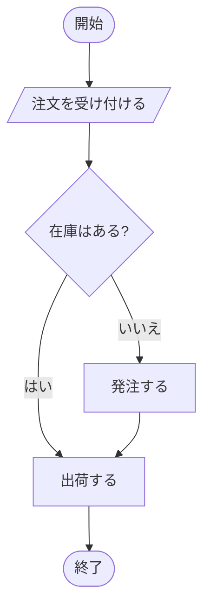

## 10. シーケンス図

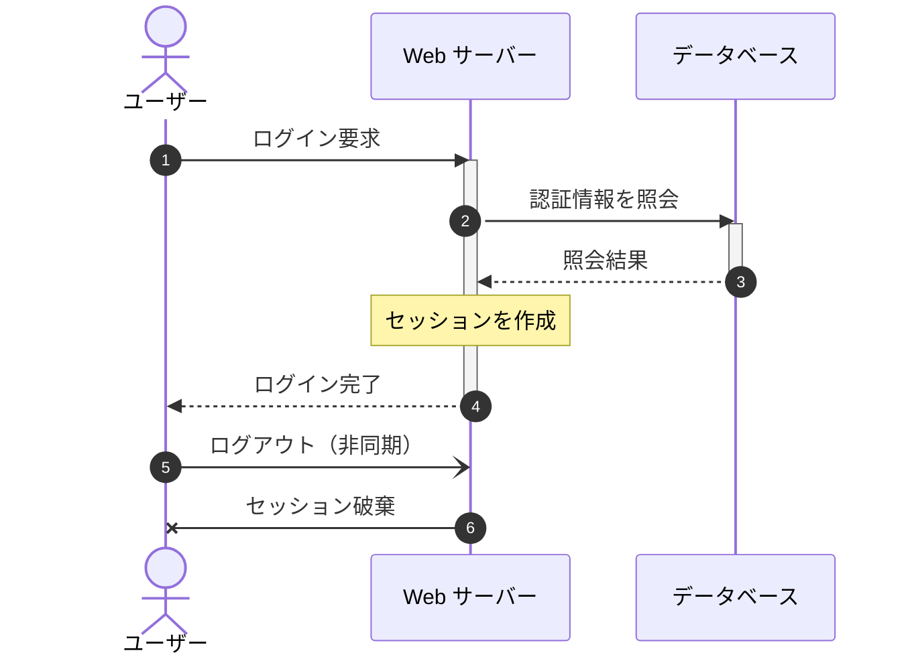

## 11. クラス図

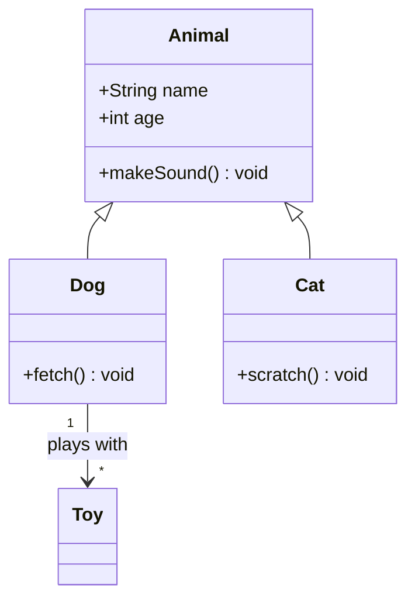

## 12. 状態遷移図

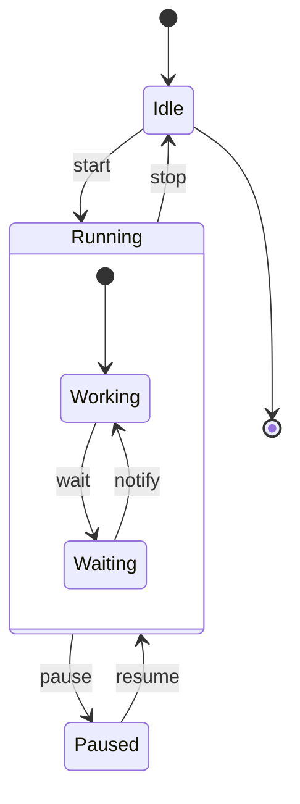

## 13. ER 図

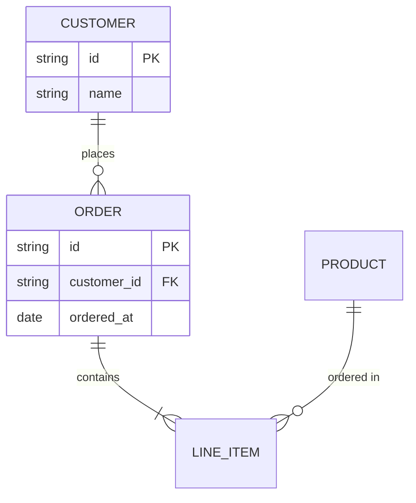

## 14. ガントチャート

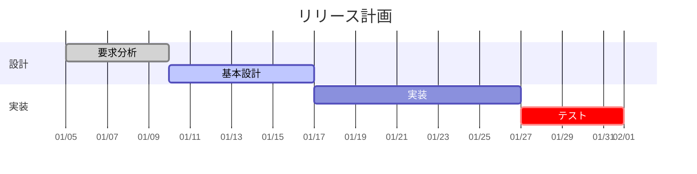

## 15. 円グラフ

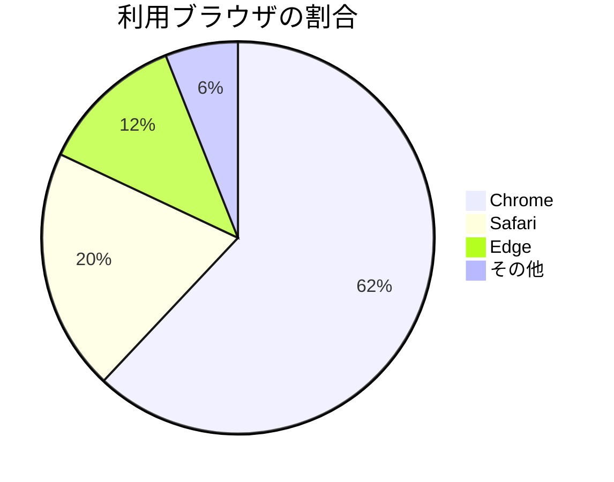

## 16. ユーザージャーニー

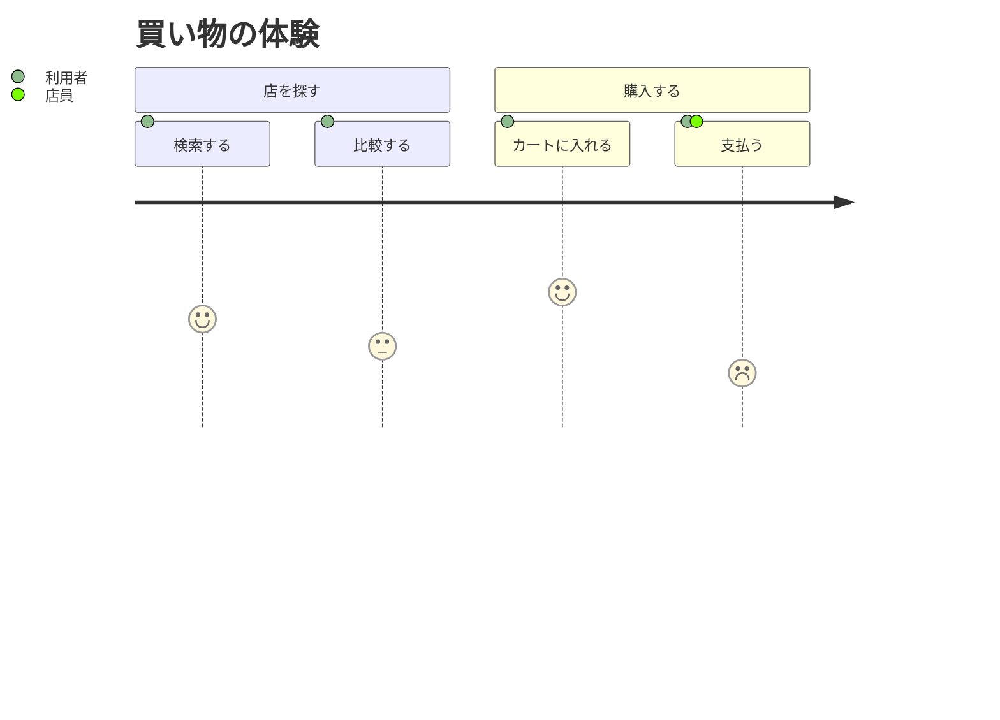

## 17. 4 象限チャート

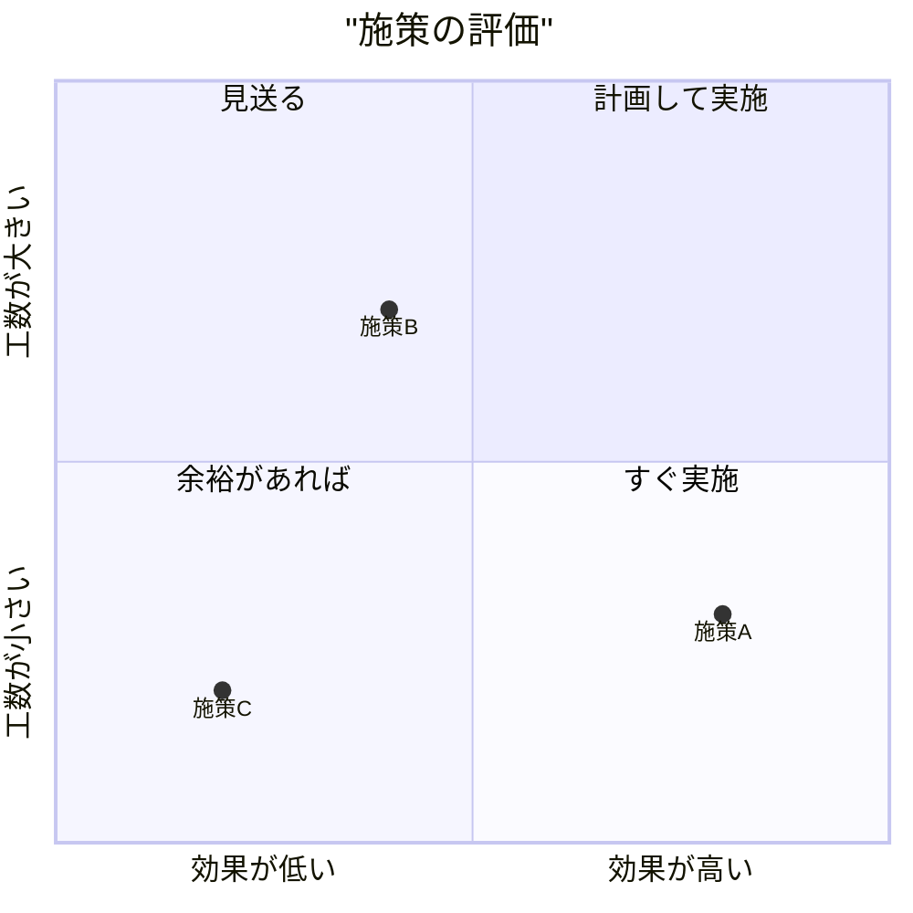

## 18. 要求図

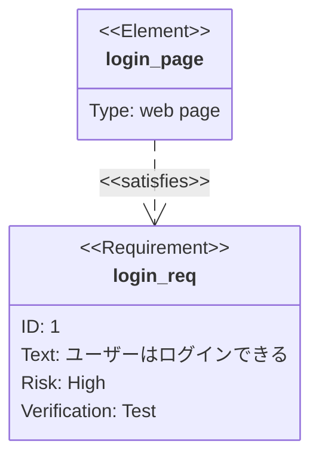

## 19. Git グラフ

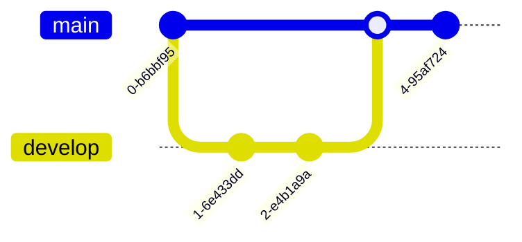

## 20. マインドマップ

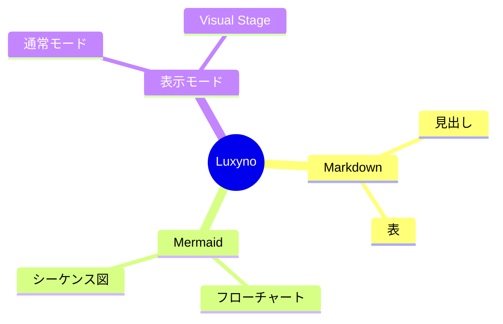

## 21. タイムライン

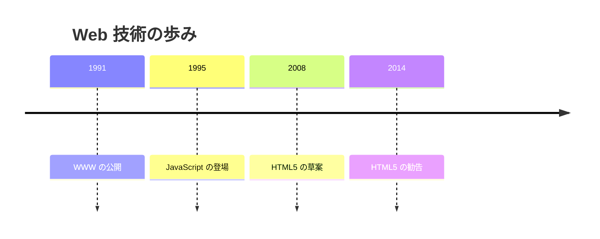

## 22. XY チャート

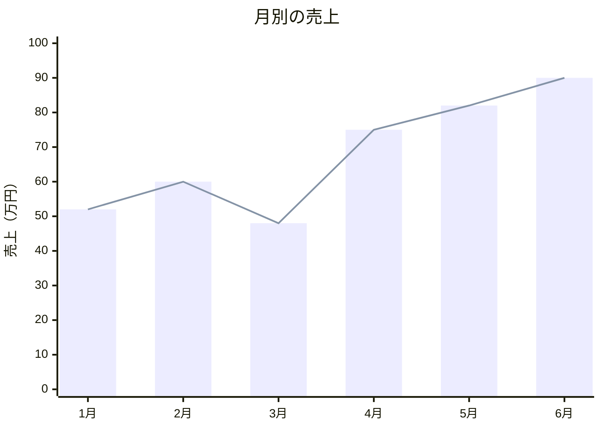

## 23. 大きなフローチャート

ノードの多い図の例です。`Fit` で全体を、`1:1` や `Expand` で細部を確認できます。

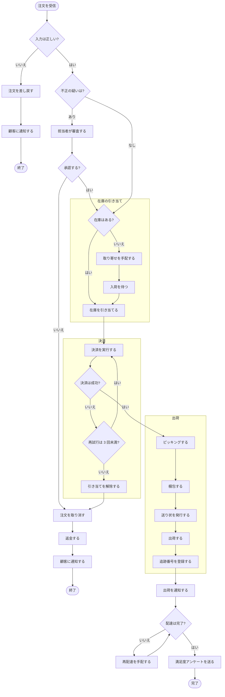

## 24. 大きな状態遷移図

状態の多い図の例です。複合状態、分岐（choice）、並行（fork / join）を含みます。

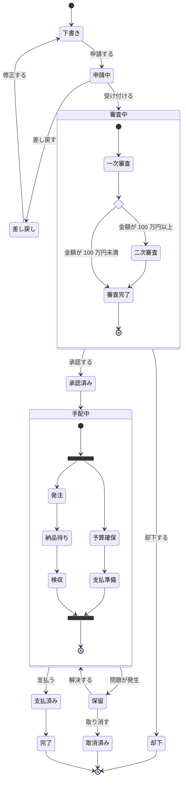

## 25. 図の中の数式

フローチャートとシーケンス図では、ラベルに `$$` で囲んだ数式を書けます。

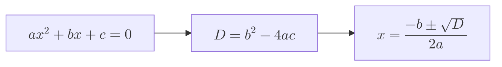

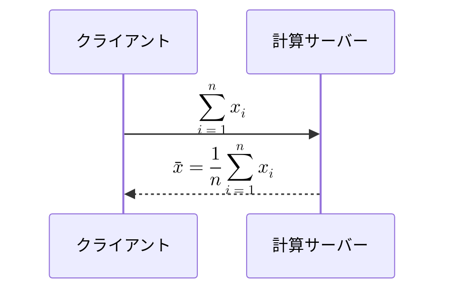
